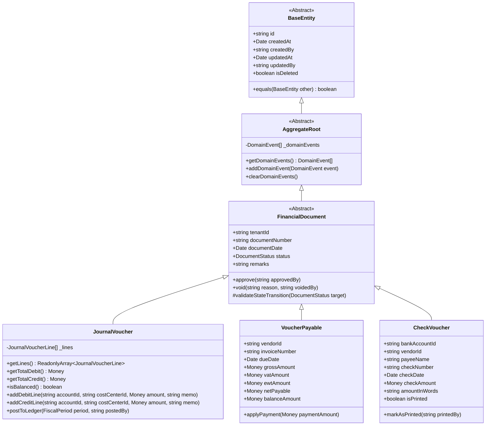
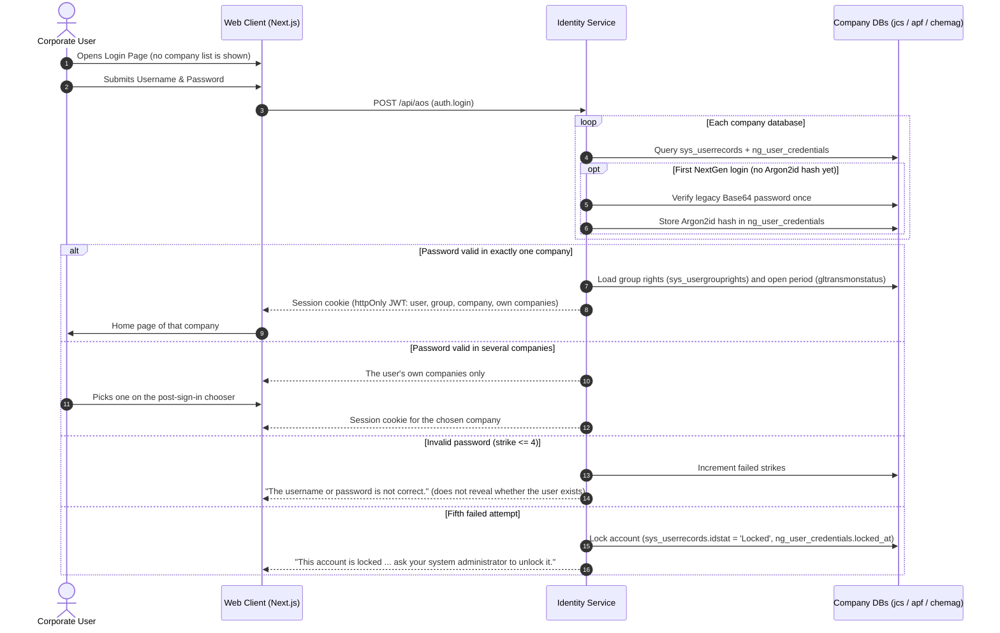
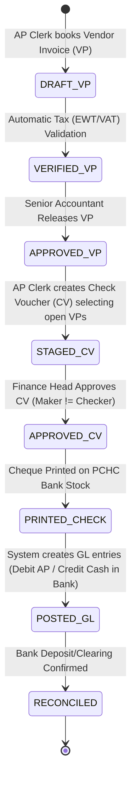
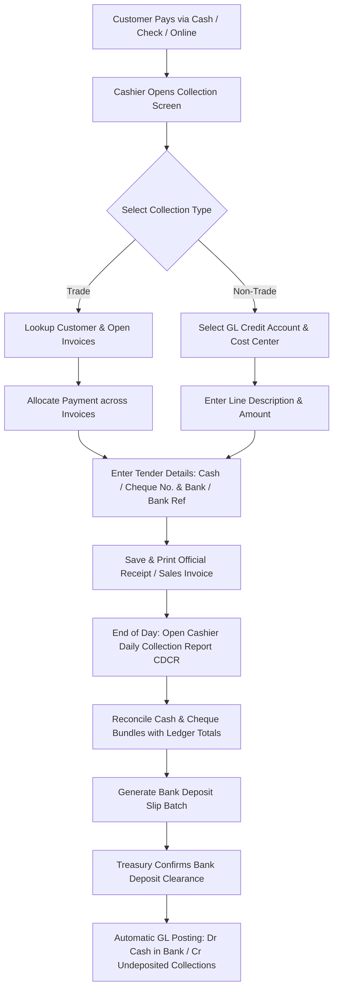
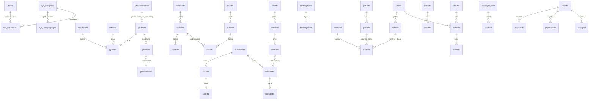

# AOS100 NextGen (JCS Co. Enterprise ERP Modernization)
## Comprehensive Master Product, Technical Architecture, Frontend Design & Engineering Blueprint

---

# Table of Contents

- [1. Executive Summary & Document Control](#1-executive-summary--document-control)
- [2. Complete Legacy Reference & System Baseline (From README.md)](#2-complete-legacy-reference--system-baseline-from-readmemd)
  - [2.1 Legacy System Overview & Multi-Tenant Entities](#21-legacy-system-overview--multi-tenant-entities)
  - [2.2 Legacy Technology Stack](#22-legacy-technology-stack)
  - [2.3 Legacy Database Architecture & Multi-Tenant Routing](#23-legacy-database-architecture--multi-tenant-routing)
  - [2.4 Complete Legacy Database Table Catalog](#24-complete-legacy-database-table-catalog)
    - [2.4.1 System, Security & Configuration](#241-system-security--configuration)
    - [2.4.2 General Ledger, Controlling & Period Control](#242-general-ledger-controlling--period-control)
    - [2.4.3 Accounts Payable, Disbursements & Withholding Tax](#243-accounts-payable-disbursements--withholding-tax)
    - [2.4.4 Cashiering, Collections & Receivables](#244-cashiering-collections--receivables)
    - [2.4.5 Sales & Distribution](#245-sales--distribution)
    - [2.4.6 Materials, Inventory, Plants & Logistics](#246-materials-inventory-plants--logistics)
    - [2.4.7 Purchasing (RIV / PO)](#247-purchasing-riv--po)
    - [2.4.8 Production & Costing](#248-production--costing)
    - [2.4.9 HR, Attendance & Payroll](#249-hr-attendance--payroll)
    - [2.4.10 Per-User Working Tables (`temp*`)](#2410-per-user-working-tables-temp)
    - [2.4.11 Corrections to the Previous Catalog](#2411-corrections-to-the-previous-catalog)
  - [2.5 Legacy File-System Storage & Config Files](#25-legacy-file-system-storage--config-files)
  - [2.6 Legacy Application Flow & Navigation Architecture](#26-legacy-application-flow--navigation-architecture)
  - [2.7 Complete Legacy Form Inventory & Form Codes](#27-complete-legacy-form-inventory--form-codes)
    - [2.7.1 System, Security & Configuration](#271-system-security--configuration)
    - [2.7.2 General Ledger, Controlling & Period Control](#272-general-ledger-controlling--period-control)
    - [2.7.3 Accounts Payable, Disbursements & Withholding Tax](#273-accounts-payable-disbursements--withholding-tax)
    - [2.7.4 Cashiering, Collections & Receivables](#274-cashiering-collections--receivables)
    - [2.7.5 Sales & Distribution](#275-sales--distribution)
    - [2.7.6 Materials, Inventory, Plants & Logistics](#276-materials-inventory-plants--logistics)
    - [2.7.7 Purchasing (RIV / PO)](#277-purchasing-riv--po)
    - [2.7.8 Production & Costing](#278-production--costing)
    - [2.7.9 HR, Attendance & Payroll](#279-hr-attendance--payroll)
    - [2.7.10 Printed Forms & Reports (Crystal Reports)](#2710-printed-forms--reports-crystal-reports)
    - [2.7.11 Menu Entries With No Page Behind Them](#2711-menu-entries-with-no-page-behind-them)
  - [2.8 Legacy Deployment & Local Execution Runbook](#28-legacy-deployment--local-execution-runbook)
  - [2.9 Legacy Directory & File Structure](#29-legacy-directory--file-structure)
  - [2.10 Critical Legacy Technical Debt & Risk Analysis](#210-critical-legacy-technical-debt--risk-analysis)
- [3. Document 1: Product Requirements Document (PRD)](#3-document-1-product-requirements-document-prd)
  - [3.1 Product Vision & Business Drivers](#31-product-vision--business-drivers)
  - [3.2 Target Audience & User Personas](#32-target-audience--user-personas)
  - [3.3 Scope of Business Modules](#33-scope-of-business-modules)
    - [3.3.1 Like-for-Like Scope (rebuild of existing pages)](#331-like-for-like-scope-rebuild-of-existing-pages)
    - [3.3.2 Optional Enhancements (new features, need client approval)](#332-optional-enhancements-new-features-need-client-approval)
  - [3.4 Regulatory & Tax Compliance Specifications (BIR / EOPT / PCHC)](#34-regulatory--tax-compliance-specifications-bir--eopt--pchc)
  - [3.5 Success Metrics & Non-Functional Requirements (NFRs)](#35-success-metrics--non-functional-requirements-nfrs)
- [4. Document 2: Technical Design Document (TDD)](#4-document-2-technical-design-document-tdd)
  - [4.1 Target System Architecture (Next.js 15 Full-Stack TypeScript + Clean Domain Architecture)](#41-target-system-architecture-nextjs-15-full-stack-typescript--clean-domain-architecture)
  - [4.2 Modern Technology Stack (Retiring VB.NET, Keeping MySQL)](#42-modern-technology-stack-retiring-vbnet-keeping-mysql)
  - [4.3 Database Strategy: Existing MySQL Retained (Database-per-Company)](#43-database-strategy-existing-mysql-retained-database-per-company)
  - [4.4 Security, Authentication & Cryptography](#44-security-authentication--cryptography)
  - [4.5 Reporting & Cheque Printing Subsystem](#45-reporting--cheque-printing-subsystem)
  - [4.6 Dockerization & Multi-Container Architecture](#46-dockerization--multi-container-architecture)
    - [4.6.1 Full-Stack Web App Containerization (`Dockerfile`)](#461-full-stack-web-app-containerization-dockerfile)
    - [4.6.2 Docker Compose for Local Development (`docker-compose.yml`)](#462-docker-compose-for-local-development-docker-composeyml)
  - [4.7 Object-Oriented Programming (OOP) & Domain-Driven Design (DDD) Specifications](#47-object-oriented-programming-oop--domain-driven-design-ddd-specifications)
    - [4.7.1 Core OOP Principles in TypeScript](#471-core-oop-principles-in-typescript)
  - [4.8 Firebase Ready Deployment Architecture (Hosting & Cloud Run / App Hosting)](#48-firebase-ready-deployment-architecture-hosting--cloud-run--app-hosting)
    - [4.8.1 Firebase Hosting Single-Origin Gateway (`firebase.json`)](#481-firebase-hosting-single-origin-gateway-firebasejson)
    - [4.8.2 Project Configuration (`.firebaserc`)](#482-project-configuration-firebaserc)
    - [4.8.3 Automated One-Click Firebase Deployment Workflow](#483-automated-one-click-firebase-deployment-workflow)
- [5. Document 3: Application Flow & Role-Based Journeys](#5-document-3-application-flow--role-based-journeys)
  - [5.1 Unified Authentication & Company Resolution Flow](#51-unified-authentication--company-resolution-flow)
  - [5.2 Role-Based Access Control (RBAC) & Segregation of Duties Matrix](#52-role-based-access-control-rbac--segregation-of-duties-matrix)
  - [5.3 Core Operational User Journeys](#53-core-operational-user-journeys)
- [6. Document 4: Frontend Design & UI/UX Architecture Specification](#6-document-4-frontend-design--uiux-architecture-specification)
  - [6.1 Design System & Visual Identity ("FinTech Precision")](#61-design-system--visual-identity-fintech-precision)
    - [6.1.1 Aesthetic Philosophy](#611-aesthetic-philosophy)
    - [6.1.2 Color Palette & Semantic Tokens](#612-color-palette--semantic-tokens)
    - [6.1.3 Typography Best Suited for Data-Dense Financial Tables](#613-typography-best-suited-for-data-dense-financial-tables)
    - [6.1.4 Spacing, Border-Radius & Shadow Guidelines](#614-spacing-border-radius--shadow-guidelines)
  - [6.2 Global Layout Architecture & Shell](#62-global-layout-architecture--shell)
  - [6.3 Role-Based UI Dynamic Rendering](#63-role-based-ui-dynamic-rendering)
  - [6.4 Key Screen UI Breakdowns](#64-key-screen-ui-breakdowns)
    - [6.4.1 Executive Financial Dashboard](#641-executive-financial-dashboard)
    - [6.4.2 Data-Heavy Tables (General Ledger & Virtualized Accounting Grids)](#642-data-heavy-tables-general-ledger--virtualized-accounting-grids)
    - [6.4.3 Complex Multi-Step Forms (Voucher Creation & BIR Form 2307)](#643-complex-multi-step-forms-voucher-creation--bir-form-2307)
    - [6.4.4 Print-Ready Views & Cheque Printing Alignment](#644-print-ready-views--cheque-printing-alignment)
  - [6.5 Component Library & Tech Stack Strategy](#65-component-library--tech-stack-strategy)
    - [6.5.1 Recommended Frontend Stack](#651-recommended-frontend-stack)
    - [6.5.2 Core Reusable UI Component Specifications](#652-core-reusable-ui-component-specifications)
  - [6.6 State Management & Data Fetching Architecture](#66-state-management--data-fetching-architecture)
- [7. Document 5: Database Design (Existing MySQL Schema)](#7-document-5-database-design-existing-mysql-schema)
  - [7.1 Core Entity Relationships (Legacy Tables)](#71-core-entity-relationships-legacy-tables)
  - [7.2 Additive NextGen Tables (`ng_*`)](#72-additive-nextgen-tables-ng_)
  - [7.3 NextGen Domain Model to Legacy Table Mapping](#73-nextgen-domain-model-to-legacy-table-mapping)
  - [7.4 Schema Verification Before Build](#74-schema-verification-before-build)
- [8. Document 6: Engineering Plan & Phased Roadmap](#8-document-6-engineering-plan--phased-roadmap)
  - [8.1 Phases & Sprints](#81-phases--sprints)
  - [8.2 Phase Task Matrix](#82-phase-task-matrix)
  - [8.3 Coexistence, Verification & Module Switch-Over (No Data Migration)](#83-coexistence-verification--module-switch-over-no-data-migration)
- [Appendix A: Legacy Table Column Reference](#appendix-a-legacy-table-column-reference)
- [Appendix B: Form Coverage Checklist](#appendix-b-form-coverage-checklist)

---

# 1. Executive Summary & Document Control

| Attribute | Details |
| :--- | :--- |
| **Project Designation** | AOS100 NextGen (JCS Co. Enterprise ERP Modernization) |
| **Predecessor System** | AOS100 Web (ASP.NET Web Forms, VB.NET, .NET Framework 4.6, MySQL 5.7, SAP Crystal Reports 13.0) |
| **Target Organizations** | **JCS Chemical Industries, Inc.** (BA 8100), **APF Corporation** (BA 8200), **Chemag Trading Corporation** (BA 8300) |
| **Core Strategy** | **Upgrade the application, keep the database.** NextGen is a new web application that connects to the client's **existing MySQL databases** (`jcs`, `apf`, `chemag`, plus shared `bfi` / `bfi_admin`). No data migration, no re-encoding, no "big bang" cutover. Legacy and NextGen run side by side on the same data while modules are switched over one at a time. |
| **Document Purpose** | Architectural, product, UI/UX and engineering specification for NextGen, including the complete legacy table catalog (Section 2.4, Appendix A) and complete legacy form inventory (Section 2.7, Appendix B). |
| **Compliance Mandates** | Philippine Tax Code (TRAIN Law, CREATE Act, Ease of Paying Taxes Act - RA 11976), BIR CAS (Computerized Accounting System) Regulations (RMC 10-2020 / RR 9-2009), Philippine Data Privacy Act of 2012 (RA 10173), Philippine Clearing House Corporation (PCHC) Check Standards. |
| **Author** | Lead Software Architect, Product Lead & UI/UX Frontend Architect |
| **Delivery Approach** | 5 phases, one module group at a time, on the live database (Section 8). Indicative duration: **12 two-week sprints (~24 weeks)** for the full like-for-like scope of 78 pages and 88 printed forms; to be confirmed after the Phase 1 discovery. |
| **Client Presentation** | `PresentationNew-CloudAOS.pdf` (current client deck, product name **Cloud AOS**); `PresentationNew.MD` is its text outline. |

### Revision History

| Rev | Date | Change |
| :--- | :--- | :--- |
| 5 | 2026-10-12 | Finance Core gaps closed in the project: Petty Cash / Revolving Fund vouchers (`CashDisb.aspx`, which had no server code in the legacy project), Fund Replenishment, CA Liquidation, Budget Monitoring and Edit Auto JV Entry. Transaction codes re-checked against the legacy source: JV is `00`, petty cash `40`, weekly expense report `41`, revolving fund `44`, payroll `45`, CA liquidation `46`, gas PO `48`, delivery order `30`, sales invoice `53`, bank deposit `64`. Appendix A gains `buddettbl.year`, `dateto`, `budamt` (BudgetMonitor.aspx.vb) and `venmasttbl.pcfcust` (FundRepl.aspx.vb). Visual identity updated (Section 6.1.0). |
| 4 | 2026-10-12 | Plan applied to the project. The hosted preview is rebuilt as **Cloud AOS** on the legacy table and column names (Appendix A), with a sample-data driver and a MySQL driver for the client's databases. Sign-in no longer lists or names companies: the company comes from the account, and only users who belong to several companies get a chooser after signing in, limited to their own companies (Section 5.1). Each company has its own customised header at the top of the side menu, with no company dropdown (Section 6.2, `ng_company_branding` in Section 7.2). `SPRINTS_ROADMAP.md` rewritten to match Section 8. |
| 3 | 2026-10-11 | REA verification of the compiled `bin/AOS100web.dll` (SHA-256 `80d663a6…39ae8`, assembly `AOS100web` 3.101.1.101, .NET Framework 4.6). Confirmed: 78 page classes + 7 master pages, the 23 pages with code only in the DLL, and 88 report templates (77 embedded + 16 on disk, 3 in both, 2 test templates excluded). Added `mmplnttbl` (187 tables). Corrected the code-availability note for `POreports.aspx` and recorded menu behaviour for Costing (040), Financial Reports (063) and the commented-out Chart of Accounts (051) / Cost Center (031) entries. Product name for the client: **Cloud AOS**. |
| 2 | 2026-10-08 | Aligned with `PresentationNew.MD`: existing MySQL database retained (PostgreSQL migration and ETL removed); phased side-by-side rollout replaces the 30-day migration cutover. Table catalog rebuilt from the full code base and compiled DLL (186 tables; 10 tables that did not exist removed). Complete form inventory added (78 pages, 7 master pages, 88 printed forms, menu placeholders). Database credentials removed from this document. |
| 1 | 2026-09 | Initial blueprint (PostgreSQL target, 8 sprints). |

---

# 2. Complete Legacy Reference & System Baseline (From README.md)

This section incorporates and preserves all architectural, operational, and database documentation from the legacy `README.md` to serve as the baseline for modernization.

## 2.1 Legacy System Overview & Multi-Tenant Entities
* **Application Name**: AOS100 Web (Accounting Operations System)
* **Primary Business Scope**: Financial Accounting (General Ledger, Payables, Receivables, Cashiering, Withholding Tax, Controlling), Sales & Distribution (Sales Orders, Invoices, Salesman / DSR), Materials Management (Receiving, Delivery Orders, Inventory per Plant, Purchasing, Production & Costing, Lab Monitoring), Human Resources & Payroll, and System Administration (Users, Rights, Approvals, Voids, Clinic Monitoring). See Section 2.7 for every page.
* **Target Entities**: Multi-tenant support across 3 primary business areas:
  * **8100**: JCS Chemical Industries, Inc.
  * **8200**: APF Corporation
  * **8300**: Chemag Trading Corporation

## 2.2 Legacy Technology Stack

| Layer | Component | Details (From README.md) |
| :--- | :--- | :--- |
| **Backend Framework** | Microsoft ASP.NET Web Forms | Target Framework: **.NET Framework 4.6** |
| **Programming Language** | Visual Basic .NET (`VB.NET`) | Code-behind files (`.aspx.vb`, `.vb`) |
| **Database Management** | MySQL Server | Port 3306 (InnoDB/MyISAM), accessed via `MySql.Data.MySqlClient` |
| **Reporting Engine** | SAP Crystal Reports | Version 13.0 (`CrystalDecisions.Web` / `.rpt` templates) |
| **Frontend & UI** | AdminLTE, Bootstrap CSS, CSS3, jQuery 3.5, SweetAlert2 | Responsive tables, modals, interactive trees |
| **UI Components** | ASP.NET AJAX Control Toolkit | `AjaxControlToolkit.dll` v19.1.0.0 |
| **Development Solution** | Visual Studio Solution | `AOS100webJCS.sln` |

## 2.3 Legacy Database Architecture & Multi-Tenant Routing
All transactional, operational, and masterfile data in the legacy system persists in a **MySQL** database server running on port `3306`. The system dynamically routes queries to separate physical MySQL databases based on the user's selected Business Area (BA) stored in session state (`Session("BA")`):

| Business Area (BA) | Entity Name | Database Name | Default Connection Host |
| :--- | :--- | :--- | :--- |
| **8100** | JCS Chemical Industries, Inc. | `jcs` | `127.0.0.1` (Local) |
| **8200** | APF Corporation | `apf` | `127.0.0.1` (Local) / `192.168.3.154` (Server) |
| **8300** | Chemag Trading Corporation | `chemag` | `127.0.0.1` (Local) |
| *(shared)* | Admin requests & master-data requests | `bfi` | Same server |
| *(shared)* | Company list (`batbl`) | `bfi_admin` | Same server |

Connection strings are defined in `Web.config` / `AOS100web.dll.config` (`MyConnectionStringJCS`, `MyConnectionStringAPF`, `MyConnectionStringAPFloc`, `MyConnectionStringChem` and the matching `MyConnString*` entries). The production server address in `App_Data/ServerAddresses.ini` is a LAN address.

> [!IMPORTANT]
> **These databases are kept as they are.** NextGen connects to the same MySQL server and the same databases. Credentials are deliberately **not** reproduced in this document. The legacy application connects as `root`; NextGen must use its own least-privilege MySQL account (see Section 4.4), and the `root` password should be rotated once the legacy app is retired.

## 2.4 Complete Legacy Database Table Catalog

The catalog below lists **every table the legacy code reads or writes** (187 in total). It was built by scanning all VB.NET source files **and** the decompiled `bin/AOS100web.dll` (the DLL contains 23 pages whose source files are missing from the project folder, so source alone is incomplete). The REA pass on 2026-10-11 re-scanned the DLL's string heap and found every catalogued table plus `mmplnttbl`, which only DLL-only code references.

| Group | Tables |
| :--- | ---: |
| System, Security & Configuration | 21 |
| General Ledger, Controlling & Period Control | 12 |
| Accounts Payable, Disbursements & Withholding Tax | 11 |
| Cashiering, Collections & Receivables | 8 |
| Sales & Distribution | 20 |
| Materials, Inventory, Plants & Logistics | 22 |
| Purchasing (RIV / PO) | 7 |
| Production & Costing | 7 |
| HR, Attendance & Payroll | 25 |
| Per-user working (`temp*`) tables | 54 |
| **Total** | **187** |

Of the business tables, 8 are change-history copies (`*_update`) and 2 are database views (`view_*`).

**Databases.** Each company has its own MySQL database with the same table set: `jcs` (8100), `apf` (8200), `chemag` (8300). The code also reads two shared databases: **`bfi`** (`admtbl`, `qryreqttbl`) and **`bfi_admin`** (`batbl`). NextGen must connect to all five.

**How to read the tables.** *Used by* lists the legacy pages that touch the table; `*` marks pages that **write** to it. Known columns for every table are in [Appendix A](#appendix-a-legacy-table-column-reference).

> [!NOTE]
> This catalog comes from the application code. Before Phase 1 starts we need a **schema-only dump** (`mysqldump --no-data`) of `jcs`, `apf`, `chemag`, `bfi` and `bfi_admin` to confirm column types, keys, indexes and any tables the web app never touches (for example tables used only by the older desktop AOS100).

### 2.4.1 System, Security & Configuration

| Table | Purpose | Used by (`*` = writes) |
| :--- | :--- | :--- |
| `admtbl` | IT / admin request log (request type, module, status). Lives in the shared **`bfi`** database. | DocQuery* |
| `authtbl` | Approval authority matrix: per user, module / form / TC and maximum approvable amount. | APapp, AuthConfig*, PurcApp, SOapp |
| `batbl` | Business areas / companies (`8100`, `8200`, `8300`) **and company settings**: name, short name, address, TINs, BIR signatory for forms, default approvers and department cost centers, SSS / PhilHealth / HDMF contribution schedule flags, data-load status. A copy also lives in the `bfi_admin` database. | AOSappConfig, APapp, Attendance, CDCR, CustMast, DailySalesReport, DeliveryOrder, DocConfig*, DocQuery, FIreportViewer, FS, FSChemag, JournalVoucher, Liquidation, Login, Maintenance, PayrollAcctg, PayrollAdjt, PurcApp, ReportViewer, SalesInvoice, VendorMast, VoucherPayables, login |
| `depttbl` | Department master (code, name). | APapp, FundRepl, MMreportViewer, PO, POreports, RIV, ReportViewer, VoucherPayables |
| `doclocktbl` | Document locks that stop two users editing the same document. | DeliveryOrder*, SalesInvoice* |
| `formstbl` | Form code reference list used by Authorization Configuration. | AuthConfig |
| `mmplnttbl` | Structure template for per-user plant access: User Maintenance runs `CREATE TABLE userplnttbl LIKE mmplnttbl` when the user-plant table is missing. Found only in the DLL. | UserMaintenance |
| `prttbl` | Document print and reprint log (reprint counter per document). | DocQuery*, PO*, RIV*, VoucherPayables* |
| `qryreqttbl` | Master-data requests (e.g. new customer or vendor number) and their status. Referenced in both the company DB and the shared **`bfi`** database. | CustMast, DocQuery*, VendorMast* |
| `serverlogintbl` | Login session log (user, PC name, system version). | UserMaintenance |
| `signtbl` | Signatories printed on forms, per form and plant. | DeliveryOrder* |
| `sys_forms` | Form registry: form code, description, transaction code (TC), in-use flag. | UserGrpAccess*, UserMaintenance, VoidApproval |
| `sys_mymenu` | Per-user favourites menu (My Favorites). | AccountingPeriod*, MyMenu, PO*, RIV*, UserGrpAccess* |
| `sys_usergroup` | User groups (roles). | UserGrpAccess*, UserMaintenance |
| `sys_usergrouprights` | Rights per user group per form code: view, edit, insert, delete, release. | AuthConfig, UserGrpAccess*, UserMaintenance, VoidApproval, shared module |
| `sys_userrecords` | User accounts: username, **Base64 password**, user group, location, status, linked employee / salesman, contact details. | AuthConfig, ChangePassword*, Login*, ReportViewer, SD, SDrepViewer, SalesAndDist, UserGrpAccess, UserMaintenance*, login* |
| `tccodestbl` | Transaction code (TC) master: module and document name for every TC. | APapp, AccountingPeriod, DailySalesReport, SalesInvoice, VoidApproval |
| `translog` | Activity / audit log: user, form, TC, document no., action, PC IP address, timestamp. | APapp*, CDCR*, ChangePassword*, CheckVoucher*, Collection*, CustEWT*, CustMast*, DailySalesReport*, DeliveryOrder*, DepApp*, DocQuery*, FundRepl*, PO*, PurcApp*, SalesInvoice*, SalesOrder*, VendorMast*, VoucherPayables* |
| `updatetbl` | Document change log: document no., TC, who / when, original name, remarks. | CheckVoucher*, CustEWT*, CustMast*, DepApp*, DocQuery*, VendorMast* |
| `userplnttbl` | Which plants / warehouses each user may access. | UserMaintenance* |
| `voidreqtbl` | Void requests and their approval (document, TC, requester, approver, status). | SalesInvoice*, VoidApproval* |

### 2.4.2 General Ledger, Controlling & Period Control

| Table | Purpose | Used by (`*` = writes) |
| :--- | :--- | :--- |
| `acctcharttbl` | Chart of accounts: account no., description, sub-account, COS / inventory flags. | APReports, AccountingPeriod, BudgetMonitor, CashierReports, CheckVoucher, Collection, DocQuery, FIreportViewer, FS, FSChemag, GLReports, JVPosting, JVedit, JournalVoucher, Liquidation, MMReports, PayrollAcctg, ReportViewer, VoucherPayables |
| `buddettbl` | Budget detail per cost center and period (Budget Monitoring). | BudgetMonitor |
| `cctrnotbl` | Cost center master: code, description, group, branch, budget cost center, COS / expense type. | APReports, AccountingPeriod, Attendance, BudgetMonitor, COSvsASP, CheckVoucher, Collection, CustEWT, DocQuery, FIreportViewer, FS, FSChemag, GLReports, JVPosting, JVedit, JournalVoucher, Liquidation, PayrollAcctg, PayrollAdjt, PayrollID, ProductionCosting, PurcApp, ReportViewer, VoucherPayables |
| `gljvdettbl` | Journal voucher lines: account, sub-account, cost / profit center, debit / credit. | AccountingPeriod*, DocQuery, FIreportViewer, JVPosting*, JournalVoucher*, ReportViewer |
| `gljvdettbl_update` | Change history of journal voucher lines (before-edit copies). | AccountingPeriod* |
| `gljvhdrtbl` | Journal voucher headers: JV no., type, source document, totals, posting status and date. | AccountingPeriod*, CDCR, CheckVoucher, Collection, DailySalesReport, DeliveryOrder, DocQuery, FIreportViewer, JVPosting*, JournalVoucher*, Liquidation, PayrollID, ProductionCosting, ReportViewer, VoucherPayables |
| `glmaintranstbl` | Posted general ledger by account, cost center and period, with balances. | AccountingPeriod*, DocQuery, FIreportViewer, FS, FSChemag, GLReports, JVPosting*, JournalVoucher, PayrollAcctg, ProductionCosting, ReportViewer |
| `gltransmonstatus` | Fiscal period control: year / month status (open / close), reopen, audit, year-end closing type. | AccountingPeriod*, FI, FinancialAccounting, JVPosting, JVedit, JournalVoucher, Login, MM, ProductionCosting, SD, login |
| `gltranstbl` | General ledger transaction detail: every posted line by source document. | APapp*, AccountingPeriod*, BudgetMonitor, COSvsASP, CheckVoucher*, Collection*, CustEWT*, DailySalesReport*, DeliveryOrder*, DocQuery*, GLReports*, JVPosting*, JVedit*, JournalVoucher*, Liquidation, PayrollAcctg*, ProductionCosting*, SalesInvoice*, VoidApproval*, VoucherPayables* |
| `modtranstattbl` | Sub-ledger period status per module / TC per month (module-level closing). | AccountingPeriod*, CDCR, CheckVoucher, Collection, DailySalesReport, DeliveryOrder, VoucherPayables |
| `montranstbl` | Monthly transaction cut-off control by transaction type (e.g. AR). | Collection, InventoryReports |
| `pctrtbl` | Profit center master: profit center, class, trade type, production cost center. | COSvsASP, Collection, DailySalesReport, DeliveryOrder, FIreportViewer, FSChemag, InventoryReports, JournalVoucher, ProductionCosting, SDReports, SalesInvoice, SalesOrder, SalesmanModule, SmnAccessMobile |

### 2.4.3 Accounts Payable, Disbursements & Withholding Tax

| Table | Purpose | Used by (`*` = writes) |
| :--- | :--- | :--- |
| `banktbl` | Company bank accounts: account no., bank, cheque prefix, cheque size / layout. | CheckVoucher, Collection, DocQuery |
| `bir_ewttbl` | BIR expanded withholding tax codes (ATC, description, rate). | ReportViewer, VendorMast, VoucherPayables |
| `cgbatchtbl` | Contract-grower (CG / breeder) liquidation batches, linked to the paying voucher. | VoucherPayables* |
| `cvdettbl` | Cheque voucher lines: vouchers paid, GL account, debit / credit. | APReports, APapp, CheckVoucher*, DocQuery, FIreportViewer, ReportViewer, VoidApproval* |
| `cvhdrtbl` | Cheque voucher headers: bank, cheque no. / date, payee, release status. | APReports, APapp*, CheckVoucher*, DocQuery, FIreportViewer, GLReports, JVedit, JournalVoucher, ReportViewer, VoidApproval* |
| `expdettbl` | Voucher payable lines: GL account, cost / profit center, department, EWT base / code / rate. | APReports, APapp, BudgetMonitor, CheckVoucher*, DocQuery*, FIreportViewer, JournalVoucher, Liquidation, ReportViewer, VoidApproval*, VoucherPayables* |
| `exphdrtbl` | Voucher payable headers (TC 023 and related: VP, cash advance, petty cash, liquidation): audit, posting and cheque status. | APReports, APapp*, BudgetMonitor, CheckVoucher*, DocQuery*, FIreportViewer, FundRepl*, GLReports, JVedit, JournalVoucher, Liquidation, ReportViewer, VoidApproval*, VoucherPayables* |
| `fundrepltbl` | Petty-cash fund replenishments: document range, total, voucher generated. | CheckVoucher*, FundRepl*, VoidApproval*, VoucherPayables* |
| `subdoctbl` | Supporting-document types / groups used on vouchers. | VoucherPayables |
| `venmasttbl` | Vendor master: name, TIN, address, terms, EWT code, PO / MMRR-required flags, contract-grower type. | APReports, APapp, BudgetMonitor, CDCR, CheckVoucher, Collection, DocQuery, FIreportViewer, FundRepl, JVedit, JournalVoucher, Liquidation, MMReports, MMreportViewer, PO*, POreports, PurcApp, RIV, ReportViewer, VendorMast*, VoucherPayables* |
| `view_exphdr` | Database **view** over voucher payable headers (used by Fund Replenishment). | FundRepl |

### 2.4.4 Cashiering, Collections & Receivables

| Table | Purpose | Used by (`*` = writes) |
| :--- | :--- | :--- |
| `bankdepdettbl` | Bank deposit lines (CDCR no., cash and cheque amounts). | CashierReports, DocQuery, ReportViewer |
| `bankdephdrtbl` | Bank deposit headers (deposit no., date, branch). | CashierReports, DocQuery, JournalVoucher, ReportViewer |
| `cdcrtbl` | Cashier's Daily Collection Report headers: cash / cheque / online / PDC totals, deposit link. | CDCR*, DocQuery, ReportViewer |
| `coldettbl` | Collection lines: invoices settled per OR, EWT withheld and 2307 form flag, PDC flag. | ARreports, CashierReports, Collection*, CustEWT, CustMast, DailySalesReport*, DeliveryOrder*, DepApp*, DocQuery*, SalesInvoice*, SalesOrder, SalesmanModule, SmnAccessMobile, VoidApproval* |
| `colhdrtbl` | Collection / official receipt headers: OR no., customer, amount, cheque details, CDCR link. | ARreports, CDCR*, CashierReports, Collection*, CustEWT, CustMast, DepApp, DocQuery, GLReports, JournalVoucher, ReportViewer, SalesOrder, SalesmanModule, SmnAccessMobile |
| `custdmcmdettbl` | Customer debit / credit memo lines: invoice, GL account, amount, EWT form. | ARreports, Collection, CustEWT*, CustMast, DepApp, DocQuery, ReportViewer, SalesOrder, SalesmanModule, SmnAccessMobile |
| `custdmcmhdrtbl` | Customer debit / credit memo headers (TC 90 / 92 and related), approval and GL status. | APapp*, ARreports, Collection, CustEWT*, CustMast, DepApp, DocQuery*, GLReports, JournalVoucher, ReportViewer, SalesOrder, SalesmanModule, SmnAccessMobile |
| `depapptbl` | Deposit application: applying customer deposits / advance ORs to invoices. | DepApp* |

### 2.4.5 Sales & Distribution

| Table | Purpose | Used by (`*` = writes) |
| :--- | :--- | :--- |
| `amstocktbl` | Salesman "AM" stock carried per DSR (qty / weight). | DailySalesReport*, DocQuery* |
| `areatbl` | Sales area master (area no., name, coverage). | CustMast, DailySalesReport, MMReports, SDReports, SalesInvoice, SalesmanModule, SmnAccessMobile |
| `custmasttbl` | Customer master: name, address, area, salesman, credit limit, terms, discount and EWT options. | APapp, ARreports, CDCR, COSvsASP, CashierReports, Collection, CustEWT, CustMast*, DailySalesReport, DeliveryOrder, DepApp, DocQuery, InventoryReports, JVedit, JournalVoucher, Liquidation, MMReports, ReportViewer, SDReports, SDrepViewer, SOapp, SalesInvoice*, SalesOrder*, SalesmanModule, SmnAccessMobile, VendorMast*, VoucherPayables |
| `custmasttbl_update` | Change history of customer master edits. | CustMast* |
| `custmmtbl` | Customer-to-material assignment (products a customer may order). | CustMast*, DeliveryOrder*, SalesOrder*, SalesmanModule*, SmnAccessMobile* |
| `dsrnotbl` | Daily Sales Report (DSR) numbers per salesman / customer, with TC 62 / 84 / 85 totals and status. | DailySalesReport*, DocQuery*, ReportViewer |
| `plstreqtbl` | Price change requests (old vs proposed price, effectivity, status). | DocQuery* |
| `plsttbl` | Price list: current price per material per customer / area, with effectivity. | DailySalesReport, DocQuery*, SalesInvoice, SalesOrder, SalesmanModule, SmnAccessMobile |
| `pmstocktbl` | Salesman "PM" stock per DSR (qty / weight). | DailySalesReport*, DocQuery* |
| `reqsodettbl` | Sales order request lines. | SalesmanModule*, SmnAccessMobile* |
| `reqsohdrtbl` | Sales order requests entered by salesmen (Salesman / mobile module) before approval. | SalesmanModule*, SmnAccessMobile* |
| `salesdettbl` | Sales invoice lines: material, lot, qty, price, VAT, discount. | COSvsASP*, DailySalesReport*, DeliveryOrder*, DocQuery*, InventoryReports, ProductionCosting*, SDReports, SalesInvoice*, SalesOrder, SalesmanModule, SmnAccessMobile, VoidApproval* |
| `salesdettbl_update` | Change history of sales invoice lines. | DeliveryOrder*, SalesInvoice* |
| `saleshdrtbl` | Sales invoice headers: invoice, DSR, customer, gross / discount / VAT, GL and AR flags. | ARreports, COSvsASP, Collection*, CustEWT, CustMast, DailySalesReport*, DeliveryOrder*, DepApp*, DocQuery*, GLReports, InventoryReports, JVedit, JournalVoucher*, ProductionCosting, SDReports, SalesInvoice*, SalesOrder, SalesmanModule, SmnAccessMobile, VoidApproval* |
| `saleshdrtbl_update` | Change history of sales invoice headers. | DeliveryOrder*, SalesInvoice* |
| `shrinkreporttbl` | Shrinkage report per salesman / DSR (stock vs sales variance). | DailySalesReport*, DocQuery* |
| `smnmtbl` | Salesman master (no., name, area, status). | APapp, ARreports, CDCR, CashierReports, Collection, CustMast, DailySalesReport, DeliveryOrder, DocQuery, InventoryReports, MMReports, PayrollAdjt, ReportViewer, SD, SDReports, SDrepViewer, SalesAndDist, SalesInvoice, SalesOrder, SalesmanModule, SmnAccessMobile |
| `sodettbl` | Sales order lines: material, qty / weight, price, discount, served balance. | DeliveryOrder*, InventoryReports, SDReports, SDrepViewer, SalesInvoice, SalesOrder*, SalesmanModule, SmnAccessMobile |
| `sohdrtbl` | Sales order headers: customer, ship-to, plant, salesman, approval, delivery status. | ARreports, DeliveryOrder*, InventoryReports, SDReports, SDrepViewer, SOapp*, SalesInvoice, SalesOrder*, SalesmanModule, SmnAccessMobile |
| `splpricetbl` | Special prices per customer and material. | DailySalesReport |

### 2.4.6 Materials, Inventory, Plants & Logistics

| Table | Purpose | Used by (`*` = writes) |
| :--- | :--- | :--- |
| `delmontbl` | Delivery monitoring data used by MM Reports. | MMReports |
| `invadjdettbl` | Inventory adjustment lines (material, lot, qty / weight vs standard). | DeliveryOrder*, InventoryReports*, MaterialManagement |
| `invadjhdrtbl` | Inventory adjustment headers (plant, date). | DeliveryOrder*, InventoryReports*, MaterialManagement |
| `invdetmontbl` | Monthly inventory snapshot (material, lot, price) used for costing. | ProductionCosting |
| `invdettbl` | Inventory receipt lines: material, lot, qty / weight, cost, expiry, plant, PO link. | COSvsASP*, DeliveryOrder, DocQuery*, InventoryReports, LabMonitoring, MMReports, MMreportViewer, MaterialManagement, POreports, ProductionCosting*, RIV, ReportViewer, SalesOrder, SalesmanModule, SmnAccessMobile, VoidApproval* |
| `invhdrtbl` | Inventory receipt headers: MMRR receiving, returns and other incoming movements; lab and disposal status. (**MMRR data lives here** - there is no separate MMRR table.) | APReports, COSvsASP, CheckVoucher*, DeliveryOrder*, DocQuery*, GLReports, InventoryReports, JVedit, JournalVoucher, LabMonitoring*, MMReports, MMreportViewer, MaterialManagement, POreports, ProductionCosting*, ReportViewer, SalesOrder, SalesmanModule, SmnAccessMobile, VoidApproval*, VoucherPayables* |
| `invmmdettbl` | Daily inventory detail per plant and material. | InventoryReports |
| `issdettbl` | Issuance / delivery order lines: material, lot, qty / weight, price. | ARreports, COSvsASP, DailySalesReport*, DeliveryOrder*, DocQuery*, InventoryReports, MMReports, MaterialManagement, ProductionCosting*, ReportViewer, SDReports, SalesInvoice, SalesOrder, SalesmanModule, SmnAccessMobile |
| `issdettbl_update` | Change history of delivery order lines. | DeliveryOrder* |
| `isshdrtbl` | Issuance / delivery order headers (sales delivery, plant transfer, production issue): customer, plant, driver, DSR. | ARreports, COSvsASP, DailySalesReport*, DeliveryOrder*, DocQuery*, InventoryReports, MMReports, MaterialManagement, ProductionCosting, ReportViewer, SDReports, SalesInvoice*, SalesOrder, SalesmanModule, SmnAccessMobile, VoidApproval* |
| `isshdrtbl_update` | Change history of delivery order headers. | DeliveryOrder* |
| `issscrpdettbl` | Scrapping issuance lines. | DeliveryOrder* |
| `issscrphdrtbl` | Scrapping (write-off) issuance headers pending approval. | DeliveryOrder* |
| `mmastprttbl` | Print-description overrides for materials (labels / forms). | DeliveryOrder* |
| `mmasttbl` | Material master: code, description, type, group, unit, GL account, selling price, VAT, inventory level. | ARreports, COSvsASP, CustMast, DailySalesReport, DeliveryOrder, DocQuery, InventoryReports, LabMonitoring, MMReports, MMreportViewer, MaterialManagement, PO, POreports, ProdWorkSheet, ProductionCosting, RIV, ReportViewer, SDReports, SDrepViewer, SalesInvoice, SalesOrder, SalesmanModule, SmnAccessMobile |
| `movplnttbl` | Movement types allowed per plant. | DeliveryOrder, DocQuery |
| `movtbl` | Movement type master (mov code, description, form, transaction type). | DeliveryOrder, DocQuery, MMReports, ReportViewer |
| `plnttbl` | Plant / warehouse / farm master: inventory switch (`invset`), RM / FG inventory GL accounts, owner type, linked customer / vendor. | DailySalesReport, DeliveryOrder, DocQuery, FS, FSChemag, InventoryReports, LabMonitoring, MMReports, PO, ProductionCosting, PurcApp, RIV, ReportViewer, SalesInvoice, SalesOrder, SalesmanModule, SmnAccessMobile, UserMaintenance |
| `sloctbl` | Storage locations per plant and profit class. | DeliveryOrder |
| `view_dodet` | Database **view** over delivery order details. | DeliveryOrder |
| `wrrdettbl` | Warehouse return receipt lines. | DailySalesReport*, DeliveryOrder, DocQuery*, InventoryReports, MaterialManagement, SalesOrder, SalesmanModule, SmnAccessMobile |
| `wrrhdrtbl` | Warehouse return receipt (WRR) headers: returns from customers / salesmen. | DailySalesReport*, DeliveryOrder, DocQuery*, InventoryReports, MMReports, MaterialManagement, SalesOrder, SalesmanModule, SmnAccessMobile |

### 2.4.7 Purchasing (RIV / PO)

| Table | Purpose | Used by (`*` = writes) |
| :--- | :--- | :--- |
| `currencytbl` | Default currency setting for purchase orders. | PO |
| `podettbl` | Purchase order lines: material, qty, unit cost, delivered qty, RIV link. | MMreportViewer, PO*, POreports, PurcApp, RIV |
| `podettbl_update` | Change history of purchase order lines. | PO* |
| `pohdrtbl` | Purchase order headers: vendor, plant, currency, terms, approval, status. | MMreportViewer, PO*, POreports, PurcApp*, RIV, ReportViewer, VoucherPayables |
| `pohdrtbl_update` | Change history of purchase order headers. | PO*, PurcApp* |
| `rivdettbl` | Requisition lines: material, qty, approved qty, current inventory, served balance. | MMreportViewer, PO*, POreports, PurcApp*, RIV*, ReportViewer |
| `rivhdrtbl` | Requisition (RIV) headers: department, plant, requested / approved dates, status. | MMreportViewer, PO, POreports, PurcApp*, RIV*, ReportViewer |

### 2.4.8 Production & Costing

| Table | Purpose | Used by (`*` = writes) |
| :--- | :--- | :--- |
| `cosdettbl` | Production cost per lot: material, direct labour, overhead, packaging, total and average cost. | ProductionCosting* |
| `coshdrtbl` | Cost-of-sales posting header (JV no., GL status). | FS, FSChemag, GLReports, JVPosting*, JournalVoucher*, ProductionCosting, SDReports |
| `cosinvtbl` | Cost-of-sales inventory figures by date (amount, qty, weight) used by SD Reports. | SDReports |
| `lotnotbl` | Production lot numbers: lot, production type, expiry, no. of batches, status. | ProdWorkSheet |
| `prodreqdettbl` | Production request lines: material, lot, target date, status. | ProdWorkSheet |
| `prodreqhdrtbl` | Production request headers. | MMReports |
| `wipdettbl` | Work-in-process detail: material input / output per production worksheet, standard cost. | COSvsASP*, DeliveryOrder*, InventoryReports, ProductionCosting* |

### 2.4.9 HR, Attendance & Payroll

| Table | Purpose | Used by (`*` = writes) |
| :--- | :--- | :--- |
| `payadjttbl` | Payroll adjustments per employee (taxable / non-taxable). | PayrollAcctg, PayrollAdjt* |
| `paycommtbl` | Salesman commissions feeding payroll. | PayrollAcctg, PayrollAdjt |
| `paydeducttbl` | Deductions and statutory contributions per employee per payroll (SSS, PhilHealth, HDMF, withholding tax, net pay). | PayrollAcctg* |
| `paydtrtbl` | Daily time record: time in / out, shift, late and undertime hours. | Attendance* |
| `payearnmasttbl` | Earnings type master (code, description, rate). | Attendance, PayrollAcctg |
| `payearntbl` | Payroll earnings per employee per payroll: regular, overtime, holiday, night differential, absences, late. | Attendance*, HRIShome, JournalVoucher, PayrollAcctg*, PayrollAdjt |
| `payemployeetbl` | Employee master: employee no., name, status, cost center, pay type. | APapp, Attendance, PayrollAcctg, PayrollAdjt, VoucherPayables |
| `payfintbl` | Employee pay setup: rate, pay mode, statutory premiums, meal allowance. | Attendance, PayrollAcctg |
| `paygovtbirannualtbl` | BIR annual withholding tax brackets. | PayrollAcctg |
| `paygovtbirtbl` | BIR withholding tax table (per pay period). | PayrollAcctg |
| `paygovtphtbl` | Government contribution table (PhilHealth / SSS premiums). | PayrollAcctg |
| `payidnostattbl` | Payroll processing status per payroll ID (attendance, earnings, deductions, net steps with user and time). | Attendance*, PayrollAcctg*, PayrollID* |
| `payidtbl` | Payroll ID / period master: payroll no., period, pay type, status. | Attendance, HRIShome, PayrollAcctg, PayrollAdjt, PayrollID* |
| `payitemstbl` | Payroll item master (pay code, description). | PayrollAcctg, PayrollAdjt |
| `payitmccnotbl` | Payroll item to GL account mapping per cost center. | PayrollAcctg |
| `payloanmasttbl` | Employee loans (SSS / HDMF / company) with amortization schedule. | APapp*, PayrollAcctg, PayrollAdjt |
| `paymealallowtbl` | Meal allowance per employee per payroll. | PayrollAcctg |
| `payndifftbl` | Night differential hours and amounts. | Attendance*, PayrollAcctg* |
| `payndratetbl` | Night differential rate codes. | Attendance |
| `payotdtbl` | Other deductions per payroll. | PayrollAcctg, PayrollAdjt* |
| `payotearntbl` | Overtime / other earnings by code. | Attendance*, PayrollAcctg* |
| `payothrloantbl` | Other loan deductions per payroll. | PayrollAcctg* |
| `paysliptbl` | Payslip data (earnings, deductions, net pay). | GLReports, HRIShome, PayrollAcctg* |
| `payvlslapptbl` | Leave applications / approved days with running balances. | Attendance*, PayrollAcctg* |
| `payvlsltbl` | Leave balances per employee per year (VL / SL / EL). | Attendance, PayrollAcctg |

### 2.4.10 Per-User Working Tables (`temp*`)

Legacy screens fill these physical tables row-by-row with a `user` column, then read them back to build grids and reports. Some are even created at runtime, one per user (names ending in `_`). They hold no permanent business data. **NextGen does not use them** (it computes in memory / SQL), but they must stay in place while the legacy system is still running.

| Table | Module | Purpose | Used by |
| :--- | :--- | :--- | :--- |
| `tempaging` | Cashiering | AR aging work table | CustMast*, DocQuery* |
| `tempaging_` | Cashiering | AR aging work table, created per user (`tempaging_<user>`) | ARreports*, DocQuery*, SalesOrder*, SalesmanModule*, SmnAccessMobile* |
| `tempaging_or` | Cashiering | AR aging for OR application | ARreports*, Collection*, CustEWT*, DepApp* |
| `tempasp` | Sales & Distribution | Average selling price work table | InventoryReports*, SDReports*, SalesmanModule*, SmnAccessMobile* |
| `tempcostbl` | Production & Costing | Costing work table | ProductionCosting* |
| `tempcostingtbl` | Production & Costing | Production costing work table | COSvsASP*, ProductionCosting* |
| `tempcostingtbl2` | Production & Costing | Production costing work table (2) | COSvsASP* |
| `tempcustbal` | Cashiering | Customer balance work table | CustMast*, DocQuery*, ReportViewer, SDReports* |
| `tempcvdettbl` | Accounts Payable | Cheque voucher line staging | CheckVoucher* |
| `tempcwtdettbl` | Cashiering | Customer EWT (2307) staging | CustEWT* |
| `tempdmcmdetwebtbl` | Cashiering | Debit / credit memo line staging | CustEWT* |
| `tempdodet` | Materials | DO detail work table | COSvsASP*, DeliveryOrder*, InventoryReports*, ProductionCosting* |
| `tempdodet2` | Materials | DO detail work table (2) | COSvsASP* |
| `tempdodet_` | Materials | DO detail work table, per user | InventoryReports*, MMReports* |
| `tempdodetprt` | Materials | DO print work table | ReportViewer*, SDReports* |
| `tempdsreport` | Sales & Distribution | Daily sales report work table | DailySalesReport*, ReportViewer |
| `tempdsrstck` | Sales & Distribution | DSR stock work table | DailySalesReport* |
| `tempexpdettbl` | Accounts Payable | Voucher line staging | BudgetMonitor*, FS*, FSChemag*, VoucherPayables* |
| `tempexphdrtbl` | Accounts Payable | Voucher header staging | APapp* |
| `tempexpsumtbl` | Accounts Payable | Expense summary work table | BudgetMonitor*, ReportViewer |
| `tempfgcostingtbl` | Production & Costing | FG costing work table | COSvsASP* |
| `tempgledit` | General Ledger | Auto-JV edit staging | JVedit* |
| `tempgljvdettbl` | General Ledger | JV line staging | JournalVoucher* |
| `tempgljvtbl` | General Ledger | JV source work table | AccountingPeriod* |
| `tempglmaintbl` | General Ledger | GL report work table | GLReports*, JournalVoucher* |
| `tempglmaintbl_` | General Ledger | GL report work table, per user | GLReports* |
| `tempgltranstbl` | General Ledger | GL detail work table | JVedit*, JournalVoucher*, Liquidation* |
| `tempgltranstbl_` | General Ledger | GL detail work table, per user | GLReports* |
| `tempinvbals` | Materials | Inventory balance work table | MMreportViewer, POreports*, SDReports*, SalesOrder*, SalesmanModule*, SmnAccessMobile* |
| `tempinvbalsnew_` | Materials | Inventory balance work table, per user | SalesOrder*, SalesmanModule*, SmnAccessMobile* |
| `tempinvdettbl` | Materials | Inventory line work table | APReports*, COSvsASP*, DeliveryOrder* |
| `tempinvtbl` | Materials | Stock card work table | DeliveryOrder*, InventoryReports*, MaterialManagement* |
| `tempinvtbl2` | Materials | Stock card with cost work table | DeliveryOrder*, InventoryReports*, MaterialManagement* |
| `tempissdettbl` | Materials | Issuance line staging | DeliveryOrder* |
| `tempisshdrtbl` | Materials | Issuance header work table | InventoryReports*, MMReports* |
| `templotnotbl` | Materials | Lot number work table | DeliveryOrder* |
| `tempmodstattbl` | General Ledger | Module period-status work table | AccountingPeriod* |
| `temppayadjt` | HR | Payroll adjustment staging | PayrollAdjt* |
| `temppaycommtbl` | HR | Commission staging | PayrollAdjt* |
| `temppaydeno` | HR | Payroll cash denomination breakdown | PayrollAcctg* |
| `temppayearntbl` | HR | Earnings staging | Attendance* |
| `temppayloansalltbl` | HR | Loan summary work table | PayrollAcctg* |
| `temppayndifftbl` | HR | Night differential staging | Attendance* |
| `temppayotd` | HR | Other deductions staging | PayrollAcctg*, PayrollAdjt* |
| `temppayotearntbl` | HR | OT earnings staging | Attendance* |
| `temppayothrloantbl` | HR | Other loans staging | PayrollAcctg* |
| `temppaypcgrptbl` | HR | Payroll group work table | PayrollAcctg* |
| `temppaytaxannual` | HR | Annualized tax work table | PayrollAcctg* |
| `temppayvlsltbl` | HR | Leave balance staging | Attendance*, PayrollAcctg* |
| `tempplnttbl` | Materials | Plant list work table (created at runtime `LIKE tempinvtbl`) | InventoryReports* |
| `temprivdettbl` | Purchasing | Requisition line staging | MaterialManagement*, PO*, RIV* |
| `tempsalesdettbl` | Sales & Distribution | Invoice line staging | COSvsASP*, DailySalesReport* |
| `tempsalesdettbl2` | Sales & Distribution | Invoice line staging (2) | SalesInvoice* |
| `tempsodettbl` | Sales & Distribution | Sales order line staging | SalesOrder*, SalesmanModule*, SmnAccessMobile* |

### 2.4.11 Corrections to the Previous Catalog

The previous version of this document listed tables that **do not exist** in the legacy code. They are removed from the catalog; the real storage is shown below.

| Previously listed | Where the data actually lives |
| :--- | :--- |
| `custewttbl` | Customer 2307 data is held in `coldettbl` (`ewt`, `ewtform`), `custdmcmhdrtbl` / `custdmcmdettbl` and staged in `tempcwtdettbl`. |
| `mmrrhdrtbl / mmrrdettbl` | MMRR (receiving) is stored in `invhdrtbl` / `invdettbl` (column `mmrrno`). |
| `leavetbl / leavebalancetbl` | Leave is held in `payvlsltbl` (balances) and `payvlslapptbl` (applications). |
| `attendancetbl` | Time records are in `paydtrtbl`. |
| `govidenttbl` | No separate government-ID table was found; statutory tables are `paygovtphtbl`, `paygovtbirtbl`, `paygovtbirannualtbl`. |
| `payhdrtbl` | Payroll runs are keyed by `payidtbl` with step status in `payidnostattbl`. |
| `thirteenthpaytbl / paybankexporttbl` | Not present in the legacy system - these are **new features**, not existing data. |

## 2.5 Legacy File-System Storage & Config Files
In addition to MySQL, the legacy system relies on configuration files and file-based logs on disk:
* `HRIS100web/App_Data/Companies.ini`: Lists selectable corporate entities.
* `HRIS100web/App_Data/ServerAddresses.ini`: Network host IPs for remote branch connectivity.
* `HRIS100web/App_Data/MainStat.txt`: Maintenance flag (`No` for normal operations; any other string routes traffic to `Maintenance.aspx`).
* `HRIS100web/App_Data/SystemAdvisory.txt`: Top navigation announcement banner text.
* `HRIS100web/Reports/*.rpt`: Pre-compiled Crystal Reports files for printing cheque formats, collection registers, and financial statements.
* `HRIS100web/logs/` & `c:\updater\logs\`: Plaintext audit trail logging user activity, IPs, and unhandled exceptions.

## 2.6 Legacy Application Flow & Navigation Architecture

```
                 ┌─────────────────────────────┐
                 │       User Opens Browser    │
                 └──────────────┬──────────────┘
                                │
                                ▼
                 ┌─────────────────────────────┐
                 │          Login.aspx         │
                 │   - Select Company (BA)     │
                 │   - Enter User ID & Pass    │
                 │   - Choose Server or Local  │
                 └──────────────┬──────────────┘
                                │
             ┌──────────────────┴──────────────────┐
             ▼                                     ▼
   [Validation Failure]                   [Validation Success]
   - Invalid username / pass              - Verified against `sys_userrecords`
   - Strike count increments              - Locks after 5 attempts
   - Account locks if strike > 4          - Retrieves open fiscal period
                                            from `gltransmonstatus`
                                                   │
                                                   ▼
                                  ┌────────────────────────────────┐
                                  │           Home.aspx            │
                                  │   (AOS100_main.Master Frame)   │
                                  └────────────────┬───────────────┘
                                                   │
         ┌───────────────────┬─────────────────────┼────────────────────┬───────────────────┐
         ▼                   ▼                     ▼                    ▼                   ▼
┌─────────────────┐ ┌─────────────────┐ ┌───────────────────┐ ┌───────────────────┐ ┌─────────────────┐
│  Financial      │ │    Material     │ │      Sales &      │ │  Human Resource   │ │  Administrator  │
│  Accounting     │ │   Management    │ │   Distribution    │ │    & Payroll      │ │                 │
│  (FI.master)    │ │   (MM.master)   │ │    (SD.master)    │ │   (HRIS.master)   │ │  (Admin.master) │
└────────┬────────┘ └─────────────────┘ └───────────────────┘ └───────────────────┘ └─────────────────┘
         │
         ▼
┌─────────────────────────────────────────────────────────────┐
│                 Permission Enforcement (RBAC)               │
│     `IsAllowed(UserGroup, FormCode, Action)` via MySQL      │
├─────────────────────────────────────────────────────────────┤
│  Action 1: View    │ Action 2: Edit    │ Action 3: Insert   │
│  Action 4: Delete  │ Action 5: Release │ Action 6: Autosave │
└──────────────────────────────┬──────────────────────────────┘
                                │
            ┌──────────────────┴──────────────────┐
            ▼                                     ▼
   [Permission Granted]                  [Permission Denied]
   Open target ASPX screen               Display SweetAlert modal:
   (e.g., JournalVoucher.aspx)           "Not Allowed to this Module!"
```

## 2.7 Complete Legacy Form Inventory & Form Codes

The legacy project (`AOS100web.vbproj`) contains **78 pages** and **7 master pages**. Every one is listed below with its menu entry, permission form code, purpose, where its code can be found today, and the NextGen phase that rebuilds it.

> [!WARNING]
> **23 pages have no VB source in the project folder.** Their code exists only inside the compiled `bin/AOS100web.dll` (some also have markup in `Crystal Reports Backup Files/`): `POreports.aspx`, `ProdWorkSheet.aspx`, `ProductionCosting.aspx`, `PurcApp.aspx`, `RIV.aspx`, `ReportViewer.aspx`, `SD.master`, `SDReports.aspx`, `SDrepViewer.aspx`, `SOapp.aspx`, `SalesAndDist.aspx`, `SalesInvoice.aspx`, `SalesOrder.aspx`, `SalesmanModule.aspx`, `SmnAccessMobile.aspx`, `StdTemplate.aspx`, `UserDetails.aspx`, `UserGrpAccess.aspx`, `UserMaintenance.aspx`, `VendorMast.aspx`, `VoidApproval.aspx`, `VoidReq.aspx`, `VoucherPayables.aspx`. Their logic has been recovered by decompiling the DLL so they can be rebuilt; ask the client whether the original source exists elsewhere.

Permission form codes are the values checked by `IsAllowed(group, "code", action)` against `sys_usergrouprights` (actions: 1 View, 2 Edit, 3 Insert, 4 Delete, 5 Release).

> [!NOTE]
> **REA verification (2026-10-11).** The DLL's metadata holds 274 types: 78 classes deriving from `System.Web.UI.Page`, 7 from `System.Web.UI.MasterPage` and 77 Crystal `ReportClass` wrappers (one per embedded `.rpt`). Every page and master below maps to one of those classes; class names differ from file names in six places (`FS.aspx` → `FS_JCS`, `GLReports.aspx` → `GLReportsNew`, `ARrepViewer.aspx` → `ARrepViewer1`, `UserDetails.aspx` → `UserDetails1`, `Help.aspx` → `About`, `Login.aspx` → `login`). The project file also lists `CS.aspx`, a C# test page that is **not** compiled into the DLL and is not part of the rebuild.

### 2.7.1 System, Security & Configuration

| Page | Menu entry (form code) | Purpose | Code available | NextGen phase |
| :--- | :--- | :--- | :--- | :---: |
| `Admin.master` | - | Administrator menu shell. | VB source | 1 |
| `AOS100_main.Master` | - | Main shell: company name, user, advisory banner, top navigation, document quick-query (`/query`). | VB source | 1 |
| `MyMenu.master` | - | Shell for favourites and document query. | VB source | 1 |
| `Administrator.aspx` | Top bar: Administrator | Administrator landing page. | VB source | 1 |
| `AOSappConfig.aspx` | AOS100 App Control (001) | Application control settings per company. | VB source | 1 |
| `AuthConfig.aspx` | Authorization Configuration (045) | Approval authority limits per user / form. | VB source | 1 |
| `ChangePassword.aspx` | Top bar | Change own password. | VB source | 1 |
| `ClinicMonitoring.aspx` | Clinic Monitoring (088) | Company clinic visit monitoring. | VB source | 5 |
| `DocConfig.aspx` | - | Document numbering / setup (not on any menu). | VB source | 1 |
| `DocQuery.aspx` | Top bar quick query | Cross-module document lookup with controlled corrections (DO plant / movement type, DSR no., CG source, etc.). | VB source | 5 |
| `Help.aspx` | Top bar: Help | Help page. | VB source | 1 |
| `Home.aspx` | Top bar: Home | Landing page / dashboard. | VB source | 1 |
| `Login.aspx` | - | Login with company (BA) selection, server choice, 5-strike lockout. | VB source | 1 |
| `logout.aspx` | Top bar | Sign out. | VB source | 1 |
| `Maintenance.aspx` | - | Maintenance-mode page (shown when `MainStat.txt` is not `No`). | VB source | 1 |
| `MyFavorites.aspx` | Top bar: My Favorites | User favourites (stub page; menu built from `sys_mymenu`). | VB source | 1 |
| `NewPass.aspx` | - | Forced new-password screen. | VB source | 1 |
| `ReportViewer.aspx` | - | Shared Crystal Reports viewer (CDCR, DSR, PO, RIV, VP prints). | Markup in backup folder + DLL only | 2 |
| `StdTemplate.aspx` | - | Developer page template (not a business screen; not rebuilt). | Markup in backup folder + DLL only | - |
| `UserDetails.aspx` | - | User detail view (not on any menu). | Markup in backup folder + DLL only | 1 |
| `UserGrpAccess.aspx` | Group Access (002) | Edit rights per user group per form. | **DLL only** | 1 |
| `UserMaintenance.aspx` | User Manager (001) | Create / edit users, groups, plant access, unlock accounts. | Markup in backup folder + DLL only | 1 |
| `VoidApproval.aspx` | Void Approval (003, release) | Approve / reject void requests across modules. | Markup in backup folder + DLL only | 5 |
| `VoidReq.aspx` | Void Request (003) | Void request entry (**stub page in legacy**). | **DLL only** | 5 |

### 2.7.2 General Ledger, Controlling & Period Control

| Page | Menu entry (form code) | Purpose | Code available | NextGen phase |
| :--- | :--- | :--- | :--- | :---: |
| `FI.master` | - | Financial Accounting menu shell (tree menu). | VB source | 2 |
| `AccountingPeriod.aspx` | Period Closing (006) | Month / year closing and reopening per module. | VB source | 2 |
| `BudgetMonitor.aspx` | Budget Monitoring (079) | Actual vs budget per cost center (partly marked *Under Construction*). | VB source | 2 |
| `ChartOfAcct.aspx` | - | Chart of accounts maintenance (not wired to the FI menu: the "Chart of Accounts" (051) and "Cost Center" (031) menu cases are commented out, and `CostCenterMgt.aspx` was never built). | VB source | 2 |
| `FinancialAccounting.aspx` | Top bar: Financial Accounting | FI landing page with module shortcuts. | VB source | 2 |
| `FIreportViewer.aspx` | - | Crystal Reports viewer for FI forms (JV, VP, CV, cheques, 2307). | VB source | 2 |
| `FS.aspx` | Financial Reports (063) - 8100 | Balance sheet, income statement (class `FS_JCS`). For 8200 (APF) the menu sets no page, so APF has no financial-statement screen in legacy. | VB source | 5 |
| `FSChemag.aspx` | Financial Reports (063) - 8300 | Chemag financial statements. | VB source | 5 |
| `GLReports.aspx` | GL Reports (052) | Trial balance, GL registers, subsidiary ledgers (class `GLReportsNew`). | VB source | 5 |
| `JournalVoucher.aspx` | Journal Voucher Entry (052) | Create / edit journal vouchers with DR = CR check. | VB source | 2 |
| `JVedit.aspx` | Edit Auto JV Entry (052) | Review and adjust system-generated JVs. | VB source | 2 |
| `JVPosting.aspx` | JV Posting (038) | Post approved JVs to the ledger. | VB source | 2 |

### 2.7.3 Accounts Payable, Disbursements & Withholding Tax

| Page | Menu entry (form code) | Purpose | Code available | NextGen phase |
| :--- | :--- | :--- | :--- | :---: |
| `APapp.aspx` | Document Posting (027) | FI approval and posting of vouchers and other documents. | VB source | 2 |
| `APReports.aspx` | A/P Reports (032) | AP registers, aging, vendor balances. | VB source | 2 |
| `CashDisb.aspx` | Petty Cash Voucher (026) | Petty cash disbursements. | VB source | 2 |
| `CheckVoucher.aspx` | Check Voucher (024) | Prepare cheque vouchers and print cheques. | VB source | 2 |
| `FundRepl.aspx` | Fund Replenishment (028) | Replenish petty-cash funds into a voucher. | VB source | 2 |
| `Liquidation.aspx` | CA Liquidation (038) | Cash advance liquidation (single / multi vendor). | VB source | 2 |
| `VendorMast.aspx` | Vendor (030) | Vendor master maintenance. | Markup in backup folder + DLL only | 2 |
| `VoucherPayables.aspx` | Voucher Payable - 023 Create/Edit, 023 View/Print | Book vendor invoices and expenses with VAT / EWT. | **DLL only** | 2 |

### 2.7.4 Cashiering, Collections & Receivables

| Page | Menu entry (form code) | Purpose | Code available | NextGen phase |
| :--- | :--- | :--- | :--- | :---: |
| `ARreports.aspx` | A/R Reports (014) | AR aging, statements of account, registers. | VB source | 3 |
| `ARrepViewer.aspx` | - | Crystal Reports viewer for AR (class `ARrepViewer1`). | VB source | 3 |
| `BankDep.aspx` | Bank Deposit (011) | Bank deposit preparation from CDCRs. | VB source | 3 |
| `CashierReports.aspx` | Cashier's Reports (047) | Collection and deposit registers. | VB source | 3 |
| `CDCR.aspx` | Cashier's Daily Collection Report (011) | Daily collection report per cashier. | VB source | 3 |
| `Collection.aspx` | Collection (010) | Official receipts: cash / cheque / online, invoice application, EWT. | VB source | 3 |
| `CustDMCM.aspx` | Customer Debit Memo (013) / Credit Memo (070) | Customer debit and credit memos (menu links to `CustomerDMCM.aspx`). | VB source | 3 |
| `CustEWT.aspx` | Customer's EWT (066) | Customer creditable withholding tax (BIR 2307) recording and offset. | VB source | 3 |
| `DepApp.aspx` | Deposit Application (012) | Apply customer deposits / advance ORs to invoices. | VB source | 3 |

### 2.7.5 Sales & Distribution

| Page | Menu entry (form code) | Purpose | Code available | NextGen phase |
| :--- | :--- | :--- | :--- | :---: |
| `SD.master` | - | Sales & Distribution menu shell (**source missing**). | **DLL only** | 3 |
| `CustMast.aspx` | Customer (020) | Customer master maintenance, Excel import, change requests. | VB source | 3 |
| `DailySalesReport.aspx` | Event Sales Report (095) | Salesman daily sales report (DSR): stock, sales, shrinkage. | VB source | 3 |
| `SalesAndDist.aspx` | Top bar: Sales & Distribution | SD landing page. | Markup in backup folder + DLL only | 3 |
| `SalesInvoice.aspx` | Sales Invoice (019) | Create / edit sales invoices. | Markup in backup folder + DLL only | 3 |
| `SalesmanModule.aspx` | Salesman's Access (076) / Sales Manager's Access (077) | Salesman order requests, stock and AR views. | Markup in backup folder + DLL only | 3 |
| `SalesOrder.aspx` | Sales Order (017) | Create sales orders with stock and credit checks. | Markup in backup folder + DLL only | 3 |
| `SDReports.aspx` | SD Reports (017) | Sales registers and analysis (partly *Under Construction*). | Markup in backup folder + DLL only | 3 |
| `SDrepViewer.aspx` | - | Crystal Reports viewer for SD. | Markup in backup folder + DLL only | 3 |
| `SmnAccessMobile.aspx` | Salesman / Sales Manager's Access (Mobile) | Mobile version of the salesman module. | Markup in backup folder + DLL only | 3 |
| `SOapp.aspx` | SO Approval (018) | Approve sales orders. | Markup in backup folder + DLL only | 3 |

### 2.7.6 Materials, Inventory, Plants & Logistics

| Page | Menu entry (form code) | Purpose | Code available | NextGen phase |
| :--- | :--- | :--- | :--- | :---: |
| `MM.master` | - | Materials Management menu shell. | VB source | 4 |
| `DeliveryOrder.aspx` | Issuance (DO) - 007 Create/Edit, 007 View/Print | Delivery orders, plant transfers, returns (WRR), scrapping, adjustments. | VB source | 4 |
| `InventoryReports.aspx` | Inventory Reports (034) | Stock card, balances per plant, valuation, inventory adjustments. | VB source | 4 |
| `LabMonitoring.aspx` | Lab Monitoring (087) | Laboratory status of received / produced lots. | VB source | 4 |
| `MaterialManagement.aspx` | Top bar: Material Management | MM landing page. | VB source | 4 |
| `MMReports.aspx` | Registers (034) | MM registers grouped by plant, material, customer. | VB source | 4 |
| `MMreportViewer.aspx` | - | Crystal Reports viewer for MM. | VB source | 4 |
| `MMRR.aspx` | Receiving (MMRR) - 050 Create/Edit, 050 View/Print | Material receiving reports against POs. | VB source | 4 |

### 2.7.7 Purchasing (RIV / PO)

| Page | Menu entry (form code) | Purpose | Code available | NextGen phase |
| :--- | :--- | :--- | :--- | :---: |
| `PO.aspx` | PO Processing (035) | Purchase orders. | VB source | 4 |
| `POreports.aspx` | PO Reports (037) | PO registers and monitoring. | Markup in web folder + DLL only | 4 |
| `PurcApp.aspx` | PO Approval (036) / RIV Approval (058) | Approve POs and RIVs. | **DLL only** | 4 |
| `RIV.aspx` | RIV Processing (054) | Requisitions (RIV). | **DLL only** | 4 |

### 2.7.8 Production & Costing

| Page | Menu entry (form code) | Purpose | Code available | NextGen phase |
| :--- | :--- | :--- | :--- | :---: |
| `COSvsASP.aspx` | COS vs ASP Analysis (059) | Cost of sales vs average selling price margin analysis. | VB source | 4 |
| `ProductionCosting.aspx` | Costing Module (040) | Production lot costing (material, labour, overhead). The menu opens it for 8100 only; for 8200 / 8300 the entry does nothing. | Markup in backup folder + DLL only | 4 |
| `ProdWorkSheet.aspx` | Prodn Worksheet (033) | Production worksheet: requests, lots, material input / output. | **DLL only** | 4 |

### 2.7.9 HR, Attendance & Payroll

| Page | Menu entry (form code) | Purpose | Code available | NextGen phase |
| :--- | :--- | :--- | :--- | :---: |
| `HRIS.master` | - | HRIS menu shell. | VB source | 5 |
| `Attendance.aspx` | Manual Entry - 301 Create / 301 View | Attendance / DTR entry and upload, OT, night differential. | VB source | 5 |
| `HRIShome.aspx` | Top bar: HRIS | HRIS landing page. | VB source | 5 |
| `PayrollAcctg.aspx` | Payroll Processing - Monthly 204/207, Weekly 205/208 | Compute payroll: earnings, deductions, tax, payslips, GL entries. | VB source | 5 |
| `PayrollAdjt.aspx` | Adjustment 210 Create / 210 View | Payroll adjustments and other deductions. | VB source | 5 |
| `PayrollID.aspx` | Payroll ID | Create payroll periods (payroll IDs). | VB source | 5 |

### 2.7.10 Printed Forms & Reports (Crystal Reports)

The legacy system prints 88 Crystal Reports templates (cheques, vouchers, BIR 2307, DO / MMRR / PO / RIV / SO forms, registers), embedded in the DLL or stored in `HRIS100web/Reports/`; two test templates are left out. Each must be re-created as a PDF template in the phase that owns its module, and checked side by side against the Crystal output.

| Group | Report templates |
| :--- | :--- |
| Financial (FI / 8000 / 8100 / 8300) (26) | `8000_prtDepSum`, `8000_prtVPform`, `8000_rptCDCRreg`, `8000_rptCDCRreg_det`, `8000_rptChartofAcct`, `8000_rptFI_CVregDet`, `8000_rptFI_CVregSum`, `8000_rptFI_FundReplDet`, `8000_rptFI_RegDet`, `8000_rptFI_RegSum`, `8000_rptGLtrans`, `8000_rptGLtransAcct`, `8100_prtDMCM`, `8100_prtDMCM2`, `8300_ShrinkReport`, `FI_CVform_Chem`, `FI_prtBIR_2307_rev2018`, `FI_prtForm_CheckBDO`, `FI_prtForm_CheckReg`, `FI_prtForm_CheckReg_crossed`, `FI_prtForm_CheckSmall`, `FI_prtForm_CV`, `FI_prtForm_VP`, `FI_prtJVform`, `FI_rptCOS_Chemag`, `FI_rptPnL_ChemagNew` |
| Materials, Purchasing & Production (MM) (59) | `MM_FloorPrice`, `MM_form_BMR`, `MM_Prod_Serial_Sticker`, `MM_prt_RIV_form_rev`, `MM_prtForm_Delivery`, `MM_prtForm_Delivery2`, `MM_prtForm_DO_201`, `MM_prtForm_DO_201_Full`, `MM_prtForm_DO_apf`, `MM_prtForm_DO_chem`, `MM_prtForm_DO_Full`, `MM_prtForm_DO_New`, `MM_prtForm_MMRR`, `MM_prtForm_PickList`, `MM_prtForm_PO`, `MM_prtForm_PO_form`, `MM_prtForm_PO_form_Chem`, `MM_prtForm_RIV`, `MM_prtForm_SRR`, `MM_prtForm_SRR_APF`, `MM_prtForm_SRR_Chem`, `MM_prtFormulation`, `MM_PW_LabelReqt`, `MM_rpt_InvList`, `MM_rpt_Iss_sum`, `MM_rpt_PO_monitor`, `mm_rpt_PO_perMatl`, `MM_rptDOdet`, `MM_rptDPR_FM`, `MM_rptDPR_MatlToMatl`, `MM_rptInv_Sum`, `MM_rptInvSum`, `MM_rptMatl_Iss`, `MM_rptMatl_Iss_SumFG`, `MM_rptMM_register_Sum`, `MM_rptMMregSum`, `MM_rptMMRRdet`, `MM_rptMMRRregdet`, `MM_rptMMRRregdet2`, `MM_rptPOdet`, `MM_rptPOregSum`, `MM_rptPOregSum2`, `MM_rptProdn_Iss`, `MM_rptProdn_SumMatl`, `MM_rptProdn_SumMatlGrp`, `MM_rptProdnReg`, `MM_rptProdnReq`, `MM_rptProdnReq_jud`, `MM_rptProdnReq_RegDet`, `MM_rptProdnReq_tam`, `MM_rptProdnSum`, `MM_rptProdnSumCateg`, `MM_rptProdReq_Reg`, `MM_rptProdWS`, `MM_rptProdWS2`, `MM_rptProdWSrev`, `MM_rptRIVregSum`, `MM_WRR_Matl_Cust`, `rpt_MM_DailyProdnSum` |
| Sales (SD) (3) | `prtSO`, `SD_prtForm_SO`, `SD_prtForm_SO_chem` |

### 2.7.11 Menu Entries With No Page Behind Them

The legacy menus show more items than were ever built. These entries do nothing (or redirect back to the module home). They are **not** part of the like-for-like rebuild; the client should decide which ones become new features.

| Menu | Entries without a page |
| :--- | :--- |
| FI | Selling Price Update, Discount Update, Weekly Expense, Commission Module, Vendor Debit Memo, Deposit Confirmation, Bank Recon, Asset Entry, Depreciation, Budget Data Entry, Fund Cash Count, Prepaid Expense, Books of Accounts, Cost Center, Profit Center, Value Added Tax, Vendor EWT, Tax Reports, Bank Center, Chart of Accounts (page exists but is not wired) |
| MM | Lot No. Maintenance, Formulation Maintenance, Return (WRR)*, Material to Material, MM Request, MM Posting, Picking List (085), Log Activities, Stock Card*, Monitoring, RIV/PO Viewer, Purchase Confirmation, Adjustment View*, Adjustment Approval, Scrapping Approval*, Material, Plant/Warehouse, FG Serial Input, Issuance With Serial, Serial Monitoring, Prodn Request*, Prodn Approval |
| HRIS | OT Application / Approval, BTA Application / Approval, Leave Application / Approval, Shift Management, Leave Reports, Leave Masterfile, Attendance Reports, Payroll Reports, Payroll Items, OT Table, Piece Rate Table, Rate/Load Setup, Authority To Deduct, General Masterfile, Employee's Data, Employee's Financial, Government Table, Confidential payroll (206 / 209). The compiled menu points several of these to pages that were never built (`LeaveRequest.aspx`, `ShiftMgt.aspx`, `LeaveMast.aspx`, `HRISReport.aspx`, `PayrollItemsMgt.aspx`, `GeneralMasterfile.aspx`, `EmployeeRecord.aspx`, `EmpFinancial.aspx`). |
| Admin | System Configuration, System Log Reports, Accountable Forms Management, Document Setup |

\* The function exists inside another page: WRR, scrapping and adjustments in `DeliveryOrder.aspx`; stock card and adjustments in `InventoryReports.aspx`; production requests in `ProdWorkSheet.aspx`.

## 2.8 Legacy Deployment & Local Execution Runbook

### Prerequisites
1. **Operating System**: Windows 10, Windows 11, or Windows Server.
2. **Web Server**: Internet Information Services (IIS) or Visual Studio IIS Express.
3. **.NET Framework**: **.NET Framework 4.6** (or higher, e.g., 4.7.2 / 4.8) installed.
4. **Database**: **MySQL Server 5.7 or 8.0** running on port `3306`.
5. **Drivers & Dependencies**:
   * **MySQL Connector/NET** (installed or referenced in `bin`).
   * **SAP Crystal Reports runtime engine for .NET Framework 4.0** (v13.0.4000.0 or 13.0.3500.0).

### Execution Steps
1. **Restore `Web.config` File**:
   * Copy `HRIS100web\bin\AOS100web.dll.config` to `HRIS100web\Web.config`.
2. **Database Initialization** (development / test copy only, never the live server):
   * Ensure MySQL is running on `127.0.0.1:3306`.
   * Restore a recent backup of the client's databases: `jcs`, `apf`, `chemag`, and the shared `bfi` and `bfi_admin`.
   * Update the connection strings in `Web.config` to point at the local copy:
     ```xml
     <connectionStrings>
       <add name="MyConnectionStringJCS"
            connectionString="Server=127.0.0.1;User=root;Password=YOUR_PASSWORD;Database=jcs;Pooling=true;"
            providerName="MySql.Data.MySqlClient" />
     </connectionStrings>
     ```
3. **Run Application**:
   * Open `AOS100webJCS.sln` in Visual Studio (2013 through 2022).
   * Set `HRIS100web/Login.aspx` as Start Page.
   * Press **F5** to start IIS Express at `http://localhost:[port]/Login.aspx`.

## 2.9 Legacy Directory & File Structure

```
JCS Co/
├── AOS100webJCS.sln          # Visual Studio Solution file
├── Performance1.psess        # VS performance profiling session
├── README.md                 # Legacy documentation
├── PLAN.md                   # NextGen Modernization Master Blueprint (this document)
├── PresentationNew.MD / .pdf # Client presentation of the upgrade
├── Presentation.MD           # Earlier (long) presentation draft
│
├── Crystal Reports Backup Files/
│                             # Backup copies of page markup (.aspx) incl. pages
│                             # whose source is otherwise missing (Sales, Vendor,
│                             # User Maintenance, Void Approval, ...)
├── New folder/               # Old Debug / Release build outputs
│
└── HRIS100web/               # Main ASP.NET Web Application
    ├── Web.config            # Runtime configuration
    ├── Global.asax           # Global application lifecycle
    ├── AOS100_main.Master    # Global navigation master page
    │
    ├── FI.master             # Financial Accounting master page & TreeView
    ├── MM.master             # Materials Management master page
    ├── HRIS.master           # Human Resources master page
    ├── Admin.master          # System Administrator master page
    ├── MyMenu.master         # Favorites / User Custom master page
    │                         # (SD.master is referenced but its source is missing)
    │
    ├── *.aspx / *.aspx.vb    # 78 pages - full list in Section 2.7
    │                         # (23 have no source here; code only in bin/AOS100web.dll)
    │
    ├── App_Data/             # Flat file configurations
    │   ├── Companies.ini     # Company list (8100, 8200, 8300)
    │   ├── ServerAddresses.ini
    │   └── SystemAdvisory.txt# Marquee announcement text
    │
    ├── modules/              # Shared VB.NET business logic
    │   ├── MyDBFunctions.vb  # Database connection pooling & routines
    │   ├── UserPermissionService.vb # Role-based permissions checks
    │   └── AmtWords.vb       # Number-to-words generator for cheques
    │
    ├── Reports/              # 16 Crystal Reports files (.rpt) on disk; the rest are
    │                         # embedded in the DLL (88 business templates in total,
    │                         # full list in Section 2.7.10)
    │
    ├── bin/                  # Compiled binary assemblies
    │   ├── AOS100web.dll     # Main application binary
    │   ├── AOS100web.dll.config
    │   ├── AjaxControlToolkit.dll
    │   └── CrystalDecisions.*.dll
    │
    ├── adminlte/             # AdminLTE dashboard theme styles & scripts
    ├── css/                  # Custom stylesheets
    ├── cdn/                  # Vendor JavaScript (SweetAlert2, jQuery)
    └── logs/                 # Daily event & error logs
```

## 2.10 Critical Legacy Technical Debt & Risk Analysis
1. **Insecure Password Storage**: Passwords in `sys_userrecords` are stored in reversible Base64 format (`base64Decode()`). Any read access to the database compromises all user accounts.
2. **SQL Injection Vulnerabilities**: While modern services like `UserPermissionService` use parameterized queries, numerous `.aspx.vb` routines concatenate user input directly into dynamic SQL queries.
3. **Physical Temporary Tables Concurrency Hazards**: The legacy application writes user-specific temporary state into physical tables (`tempaging_or`, `tempcvdettbl`, `tempexpdettbl`, `tempgljvdettbl`) filtered by `user = 'username'`. Abrupt connection closures, network drops, or concurrent sessions create orphaned records, cross-user data leakage, and lock contention.
4. **Crystal Reports Obsolescence**: Version 13.0 (.NET 4.0 runtime) causes runtime crashes due to 32-bit/64-bit mismatches, cannot be containerized on modern Linux infrastructure, and prevents auto-scaling.
5. **Missing Source Code**: 23 pages (including all of Sales & Distribution, Voucher Payables, Purchasing approvals, Vendor and User Maintenance) exist only in the compiled `bin/AOS100web.dll`. The legacy app cannot be safely changed any more; NextGen rebuilds these pages from the decompiled logic.
6. **Over-privileged Database Account**: The application connects to MySQL as `root`, and the credentials sit in plain text in `Web.config`.
7. **Unfinished Menus**: More than 60 menu entries lead nowhere (Section 2.7.11), which confuses users and hides what the system really does.

---

# 3. Document 1: Product Requirements Document (PRD)

## 3.1 Product Vision & Business Drivers
**AOS100 NextGen** is a modern, cloud-native, high-performance Enterprise Resource Planning and Financial Accounting Platform engineered for industrial chemical manufacturing, feed milling, and chemical distribution. It unifies operations across JCS Chemical Industries, Inc., APF Corporation, and Chemag Trading Corporation into a single secure platform with real-time multi-tenant financial governance, sub-second ledger posting, automated Philippine regulatory tax compliance, precision MICR cheque printing, and 3-way matching for materials management.

**Guiding principle: same data, same business rules, modern system.** NextGen replaces the application layer only. It reads and writes the client's existing MySQL databases and keeps the legacy document numbering, statuses and posting rules, so years of history carry forward unchanged and both systems can run side by side during the transition.

| Business driver | How NextGen delivers it |
| :--- | :--- |
| Protect the data investment | Existing MySQL databases retained; no migration, no re-encoding. |
| Better daily experience | Modern, fast screens; keyboard-first data entry; each company sees its own branded header; instant switching between the companies a user belongs to. |
| Performance | In-page updates instead of full-page reloads; target under 200 ms for 95% of requests. |
| Works on any device | Fully responsive; approvals and lookups from phone or tablet without VPN / remote desktop. |
| Security | Modern password hashing, lockout, role-based access, parameterized SQL, full audit trail. |
| Modern reports & printing | Crystal Reports replaced by precise PDF output, printable from any browser. |
| Maintainability & scale | Mainstream TypeScript / React stack; cloud-ready; changes take days, not months. |

## 3.2 Target Audience & User Personas

| Persona | Key Responsibilities | Legacy Pain Points | NextGen Upgraded Capabilities |
| :--- | :--- | :--- | :--- |
| **CFO / Finance Director** | Corporate governance, board reporting, tax strategy across all 3 entities. | Disjointed databases, delayed month-end reports, manual consolidation. | Multi-tenant consolidated dashboard, real-time P&L by cost center, one-click intercompany eliminations. |
| **Senior Accountant** | Period closing, JV approvals, trial balance reconciliation, audit oversight. | Manual JV balancing checks, temporary table lockups, unposted entry risks. | Strict double-entry balance check ($DR = CR$), Maker-Checker workflows, automated closing entries, period locking. |
| **Accounts Payable Specialist** | Vendor invoice booking (VPs), supplier reconciliation, check voucher issuance. | Re-keying vendor TINs, manual check voucher staging, dot-matrix printer alignment errors. | 3-way PO-MMRR matching, vendor aging with credit terms, bank check layout calibration tool. |
| **Cashier / Treasury Officer** | Daily collections (OR/Invoices), CDCR, bank deposits, cheque clearing. | Manual tallying of cash vs. cheques, delayed reconciliation of PDCs. | Multi-tender collection screen, automated CDCR batching, PDC maturity calendar, automated bank deposit slips. |
| **Tax & Compliance Officer** | BIR withholding tax compliance, Form 2307 issuance, ATC code reporting. | Tedious manual computation of tax credits and manual preparation of BIR 2307. | Automated BIR 2307 PDF generation, ATC auto-tagging (WI158, WC158), SAWT data export, EOPT compliance. |
| **Materials Supervisor** | Purchase orders, material receiving (MMRR), stock cards, warehouse transfers. | Disconnect between warehouse receiving notes and accounting invoice matching. | Barcode/QR asset tracking, automated Cost of Sales (COS) calculations, minimum reorder alert triggers. |
| **IT Auditor / System Admin** | User provisioning, role permissions, access control audits, system configuration. | Hard to trace who modified records due to flat-file or basic string logging in `translog`. | Granular RBAC, SSO/MFA support, immutable audit trail with JSON before/after state diffs. |

## 3.3 Scope of Business Modules

Scope has two parts. **Like-for-like scope** is every legacy page in Section 2.7 rebuilt on the same tables (tracked in Appendix B). **Optional enhancements** are new features the legacy system does not have; each needs client approval because most need **new** tables (see Section 7.2).

### 3.3.1 Like-for-Like Scope (rebuild of existing pages)
1. **System Governance & Access**: Login (company resolved from the account, no company list on the login page) and lockout, users (`sys_userrecords`), groups and rights (`sys_usergroup`, `sys_usergrouprights`), approval limits (`authtbl`), app control, void request / approval (`voidreqtbl`), document query and controlled corrections, favourites, clinic monitoring.
2. **General Ledger & Controlling**: Chart of accounts, cost and profit centers, journal vouchers (TC 052) with auto-JV editing and posting, period closing per module (`gltransmonstatus`, `modtranstattbl`), GL reports, financial statements per company, budget monitoring.
3. **Accounts Payable & Disbursements**: Vendor master, voucher payables (TC 023) with VAT / EWT, document posting, cheque vouchers (TC 024) with cheque printing, petty cash, fund replenishment, cash advance liquidation, AP reports.
4. **Cashiering, Collections & Receivables**: Collections / ORs (TC 010) across cash, cheque and online, CDCR, bank deposits, deposit application, customer debit / credit memos, customer EWT (BIR 2307), AR aging and statements.
5. **Sales & Distribution**: Customer master (with Excel import and change requests), price lists, sales orders and approval, sales invoices, salesman and sales manager modules (desktop and mobile), daily sales reports (DSR) with stock and shrinkage, SD reports.
6. **Materials, Inventory & Plants**: Material receiving (MMRR, TC 050), delivery orders / issuances and plant transfers (TC 007), warehouse returns, scrapping, inventory adjustments, stock card and balances **per plant** (respecting each plant's `invset` switch), MM registers, lab monitoring.
7. **Purchasing**: Requisitions (RIV), purchase orders, PO / RIV approval, PO reports.
8. **Production & Costing**: Production worksheet (requests, lots, material input / output), production costing, COS vs ASP analysis.
9. **HR, Attendance & Payroll**: Attendance / DTR entry and upload, payroll IDs, monthly and weekly payroll processing (earnings, deductions, SSS / PhilHealth / HDMF, withholding tax, payslips, GL entries), payroll adjustments.
10. **Printed Forms**: All 88 legacy print templates (Section 2.7.10) re-created as PDF.

### 3.3.2 Optional Enhancements (new features, need client approval)
* Menu items that exist in legacy menus but were never built (Section 2.7.11), e.g. Bank Recon, Asset Management, Leave and OT applications, Shift Management, Employee 201 file.
* Statutory payroll updates (2026 SSS / PhilHealth / Pag-IBIG schedules), 13th-month accumulation, bank PESONet / BDO / BPI payroll export files.
* BIR SAWT / alphalist exports, PDC maturity calendar, barcode / QR stock tracking, executive dashboard and approval inbox.
* Maker-checker controls beyond what `authtbl` and the release right already enforce.

## 3.4 Regulatory & Tax Compliance Specifications (BIR / EOPT / PCHC)
* **Ease of Paying Taxes (EOPT) Act (RA 11976)**: Primary substantiating document for VAT claiming on both goods and services is standardized to the **Sales Invoice**. Official Receipts are transitioned to supplemental collection proofs.
* **BIR Form 2307 (Certificate of Creditable Tax Withheld At Source)**: Direct generation matching the exact official BIR layout with automatic Alphanumeric Tax Code (ATC) assignment (e.g., WC158 for corporate services at 2%, WC160 for corporate goods at 1%, WI010 for professional fees).
* **PCHC Cheque Standards**: Precision alignment complying with Philippine Clearing House Corporation cheque clearing regulations (exact MICR line clearance, millimeter-accurate date, payee, numerical amount, and amount-in-words placement).

## 3.5 Success Metrics & Non-Functional Requirements (NFRs)
* **Response Time**: Target under 200 ms API response time for 95% of requests (measured against the client's MySQL server; heavy reports excluded).
* **Coexistence**: NextGen and the legacy system must be able to work on the same database at the same time without corrupting each other's data (shared document numbering, statuses and `doclocktbl` locks; see Section 8.3).
* **Data Compatibility**: Every record NextGen writes must be readable and correct in the legacy screens and Crystal reports, until that module is retired.
* **Concurrency**: No data corruption under 200+ concurrent sessions across the three companies.
* **Reliability & Availability**: 99.9% application uptime. Database availability and backups remain with the client's MySQL server; NextGen adds health checks and alerts.
* **Data Integrity**: Every posting written in a single database transaction; no out-of-balance JV can be saved.

---

# 4. Document 2: Technical Design Document (TDD)

## 4.1 Target System Architecture (Next.js 15 Full-Stack TypeScript + Clean Domain Architecture)

```
┌────────────────────────────────────────────────────────────────────────┐
│               FULL-STACK MODERN WEB APPLICATION ARCHITECTURE           │
│   Next.js 15 (React 19 + TypeScript) App Router + Server Actions / APIs│
│                                                                        │
│   ┌────────────────────────────────────────────────────────────────┐   │
│   │                    PRESENTATION LAYER (UI/UX)                  │   │
│   │  - FinTech Precision Design System (Dark Shell / Slate Canvas) │   │
│   │  - High-Density Accounting Tables (TanStack Table v8 Virtual)  │   │
│   │  - Rapid Keyboard Navigation Engine (Tab / F-Keys / Shortcuts) │   │
│   │  - Client State & Caching: TanStack Query v5 + Zustand         │   │
│   └───────────────────────────────┬────────────────────────────────┘   │
│                                   │ Typed Server Actions / API Routes  │
│                                   ▼                                    │
│   ┌────────────────────────────────────────────────────────────────┐   │
│   │              APPLICATION & SECURITY LAYER (TypeScript)         │   │
│   │  - JWT Bearer Authentication & Refresh Token Rotation          │   │
│   │  - Multi-Tenant Middleware (Header: X-Tenant-Id / JWT Claim: ba│   │
│   │  - Maker-Checker Document Approval Workflow Engine             │   │
│   │  - Zod Strict Schema Validation & Rate Limiting                │   │
│   └───────────────────────────────┬────────────────────────────────┘   │
│                                   │ Orchestrates Domain Aggregates     │
│                                   ▼                                    │
│   ┌────────────────────────────────────────────────────────────────┐   │
│   │          DOMAIN LAYER (Object-Oriented & DDD Core)             │   │
│   │  - Encapsulated Aggregates: JournalVoucher, VoucherPayable,    │   │
│   │    CheckVoucher, Collection (Guaranteed DR = CR Invariant)     │   │
│   │  - Value Objects: Money (Decimal, Zero-Float), TaxRate, TIN    │   │
│   │  - Tax Strategy Engine: BIR Form 2307 ATCs (WC158, WC160)      │   │
│   │  - Cheque Layout Engine: Millimeter Vector Offset Strategies   │   │
│   └───────────────────────────────┬────────────────────────────────┘   │
│                                   │ Repositories & Unit of Work        │
│                                   ▼                                    │
│   ┌────────────────────────────────────────────────────────────────┐   │
│   │              INFRASTRUCTURE & DATA PERSISTENCE LAYER           │   │
│   │  - MySQL Connection Pool per Company DB (jcs / apf / chemag)   │   │
│   │  - Repositories mapped onto the EXISTING legacy tables         │   │
│   │  - Redis 7 Distributed Lock & Session Cache (optional)         │   │
│   │  - PDFKit / Vector PDF Generator for Cheques & BIR Form 2307   │   │
│   └───────────────────┬───────────────────────────────┬────────────┘   │
└───────────────────────┼───────────────────────────────┼────────────────┘
                        ▼                               ▼
    ┌───────────────────────────────────────┐ ┌──────────────────────────┐
    │  CLIENT'S EXISTING MySQL SERVER        │ │  CACHE & QUEUE (Redis 7) │
    │ - jcs (8100) · apf (8200) · chemag    │ │ - Idempotency Locks      │
    │   (8300) · bfi · bfi_admin            │ │ - Session Management     │
    │ - Legacy tables unchanged             │ │ - Batch Queues           │
    │ - Small additive `ng_*` tables only   │ │                          │
    └───────────────────▲───────────────────┘ └──────────────────────────┘
                        │ same data, during the transition
    ┌───────────────────┴───────────────────┐
    │  LEGACY AOS100 (VB.NET) - read/write   │
    │  until each module is switched over   │
    └───────────────────────────────────────┘
```

## 4.2 Modern Technology Stack (Retiring VB.NET, Keeping MySQL)

> [!IMPORTANT]
> **Application retired, data retained**: Visual Basic .NET (`VB.NET`), ASP.NET Web Forms (`.aspx`), and SAP Crystal Reports are retired module by module as NextGen takes over. The new platform is a **Full-Stack TypeScript** web application. The **MySQL databases are not replaced**; NextGen works directly on the existing tables.

| Layer | Modern Choice | Rationale & Legacy Improvement |
| :--- | :--- | :--- |
| **Web Application Platform** | **Next.js 15 (React 19, TypeScript)** | Unified full-stack architecture combining high-performance server-side rendering, React Server Components, and optimized API Route handlers in end-to-end TypeScript. |
| **Domain Architecture** | **Object-Oriented Programming (OOP) & DDD** | Rich domain models encapsulating financial invariants ($DR = CR$), value objects for zero-float precision, and polymorphic tax/cheque strategy patterns. |
| **API & Server Actions** | **Next.js Route Handlers + Zod Validation** | Type-safe RPC-style and REST endpoints validating inputs at compile and run time, replacing fragile ASPX code-behind event models. |
| **Component System** | **Shadcn UI (Radix Primitives) + Tailwind CSS** | Unstyled headless primitives providing full accessibility (ARIA), customized for high-density enterprise accounting grids. |
| **Data Grids & Forms** | **TanStack Table v8 + React Hook Form + Zod** | Virtualized row rendering for 50,000+ general ledger lines; client-side type-safe validation before submission. |
| **Database Engine** | **Existing MySQL server (retained)** | The client's current databases `jcs`, `apf`, `chemag`, `bfi`, `bfi_admin`. No engine change and no data migration. NextGen-only data goes into a few additive `ng_*` tables (Section 7.2). |
| **Database Access** | **Kysely (typed SQL builder) on `mysql2` connection pools** | One pool per company database, chosen from the user's selected business area. Typed queries over the legacy column names; **parameterized SQL only** (no string concatenation). Kysely is preferred over an ORM because the legacy schema has no foreign keys and few surrogate keys. |
| **Cheque & Tax Reporting** | **Vector PDF Engine (PDFKit / React-PDF)** | Programmatic vector PDF generation with millimeter-accurate coordinate calibration, replacing outdated SAP Crystal Reports. |
| **Cache & Queue** | **Redis 7 (optional)** | Prevents duplicate voucher submissions via idempotency locks. Document-level locking with the legacy system still goes through the existing `doclocktbl`. |
| **Authentication & Security** | **Argon2id + JWT + HTTP-Only Secure Cookies** | Replaces Base64 plain decoding with cryptographically salted Argon2id password hashing and short-lived JWT access tokens. |
| **Containerization** | **Docker Multi-Stage (<120MB Alpine)** | Ultra-lightweight container with non-root security. |
| **Deployment Target** | **Firebase Hosting / App Hosting & Cloud Run** | Serverless edge delivery, zero infrastructure maintenance, automatic SSL, and global CDN. |

## 4.3 Database Strategy: Existing MySQL Retained (Database-per-Company)

NextGen keeps the legacy layout exactly: **one MySQL database per company**, all with the same table set, plus two shared databases.

| Business Area | Database | Notes |
| :--- | :--- | :--- |
| 8100 JCS Chemical Industries, Inc. | `jcs` | |
| 8200 APF Corporation | `apf` | Legacy also defines a local APF connection (`MyConnectionStringAPFloc`) |
| 8300 Chemag Trading Corporation | `chemag` | |
| Shared | `bfi` | `admtbl`, `qryreqttbl` |
| Shared | `bfi_admin` | `batbl` |

**Request routing.** Every API request resolves the business area from the session token (`ba` claim) and picks the matching connection pool, the same way the legacy app uses `Session("BA")` / `Session("CurrDB")`. A user can only reach a company their group has rights to.

**Rules for working on the legacy schema**
1. **No destructive changes.** NextGen never drops, renames or changes the type of a legacy table or column while the legacy system is still running.
2. **Additive only.** Anything NextGen needs that the legacy schema lacks goes into new tables prefixed `ng_` (Section 7.2), created by versioned migration scripts that are reviewed with the client's DBA.
3. **Same business keys and numbering.** NextGen reads and increments the same document number sources, transaction codes (`tccodestbl`) and status values as the legacy screens, so a document created in either system is valid in both.
4. **Same posting rules.** GL postings write `gljvhdrtbl` / `gljvdettbl` / `gltranstbl` / `glmaintranstbl` exactly as the legacy routines do, so legacy reports and Crystal forms still balance.
5. **Respect legacy locks and period status.** NextGen honours `doclocktbl`, `gltransmonstatus` and `modtranstattbl`, and plant inventory switches (`plnttbl.invset`).
6. **No `temp*` tables.** NextGen computes aging, stock cards and costing in SQL / memory instead of the per-user working tables, but leaves those tables in place for the legacy app.
7. **Transactions.** Every multi-table save runs in a single MySQL transaction (InnoDB). Any table still on MyISAM is identified from the schema dump and converted only with client approval, because MyISAM cannot roll back.

## 4.4 Security, Authentication & Cryptography
* **Password Hashing**: Upgraded from Base64 to **Argon2id** (memory cost: 64MB, iterations: 3, parallelism: 4). Because the legacy app still reads `sys_userrecords.userpassword` during the transition, the Argon2id hash is stored in a new `ng_user_credentials` table and created on the user's first NextGen login. Once the legacy login is retired, the Base64 passwords are blanked and all users reset their password.
* **Account Lockout**: 5 failed login strikes trigger an automated account lock, requiring administrative unlock (same rule as legacy).
* **Least-privilege database account**: NextGen connects with its own MySQL user that has only `SELECT / INSERT / UPDATE / DELETE` on the company databases, not `root`. Credentials live in a secrets store / environment variables, never in source control.
* **SQL injection**: All queries are parameterized through Kysely; no SQL is built from user input.
* **Encryption in transit**: TLS between browser and app, and between app and MySQL where the server supports it.
* **Audit Trail**: NextGen keeps writing the legacy `translog` (so legacy log reports still work) **and** writes a JSON before/after snapshot to the new `ng_audit_log` table.

## 4.5 Reporting & Cheque Printing Subsystem
* Vector PDFs are generated in TypeScript (React-PDF / PDFKit), replacing all 88 Crystal Reports templates listed in Section 2.7.10.
* Each template is accepted only when its output matches the legacy Crystal output for the same documents.
* Configurable cheque layout templates store millimeter offsets (X/Y coordinates) for Payee, Date, Amount in figures, and Amount in words for each corporate bank account (BDO, BPI, Metrobank, Security Bank, Chinabank). Offsets are stored in `ng_cheque_layouts`, keyed to the legacy `banktbl` accounts.
* Amount-in-words follows the legacy `AmtWords.vb` output exactly.

## 4.6 Dockerization & Multi-Container Architecture

To guarantee deterministic builds, rapid deployment, and environment parity across local development, staging, and production, AOS100 NextGen is fully containerized with a production-grade, multi-stage Next.js 15 Full-Stack Docker configuration and orchestration.

### 4.6.1 Full-Stack Web App Containerization (`Dockerfile`)
The Next.js 15 Full-Stack Application (serving the React 19 FinTech interface and TypeScript API route handlers/server actions) uses a 3-stage minimal Alpine build (<120MB image size):
* **Stage 1 (`deps`)**: `node:22-alpine` installs dependencies via `npm ci` with clean lockfile reproducibility.
* **Stage 2 (`builder`)**: Compiles Next.js with `output: 'standalone'` enabled in `next.config.js`.
* **Stage 3 (`runner`)**: Runs as a dedicated unprivileged user `nextjs` (UID 1001), copying only the `.next/standalone` directory, public assets, and `.next/static`. Sets `NODE_ENV=production` and container health checking.

```dockerfile
# Multi-Stage Dockerfile for Next.js 15 Full-Stack TypeScript ERP
FROM node:22-alpine AS deps
RUN apk add --no-cache libc6-compat
WORKDIR /app
COPY package.json package-lock.json ./
RUN npm ci

FROM node:22-alpine AS builder
WORKDIR /app
COPY --from=deps /app/node_modules ./node_modules
COPY . .
ENV NEXT_TELEMETRY_DISABLED=1
RUN npm run build

FROM node:22-alpine AS runner
WORKDIR /app
ENV NODE_ENV=production
ENV NEXT_TELEMETRY_DISABLED=1
RUN addgroup --system --gid 1001 nodejs && adduser --system --uid 1001 nextjs
COPY --from=builder /app/public ./public
COPY --from=builder --chown=nextjs:nodejs /app/.next/standalone ./
COPY --from=builder --chown=nextjs:nodejs /app/.next/static ./.next/static
USER nextjs
EXPOSE 3000
ENV PORT=3000
HEALTHCHECK --interval=20s --timeout=5s --start-period=15s --retries=3 \
  CMD wget --no-verbose --tries=1 --spider http://localhost:3000/api/healthz || exit 1
CMD ["node", "server.js"]
```

### 4.6.2 Docker Compose for Local Development (`docker-compose.yml`)
For **development and testing only**, `docker compose up -d` starts NextGen against a **restored copy** of the client's MySQL databases. In staging and production there is no database container: NextGen points at the client's existing MySQL server through `DATABASE_HOST`.

```yaml
services:
  # Development only: MySQL loaded with a restored backup of jcs / apf / chemag / bfi / bfi_admin
  db:
    image: mysql:8.0            # match the client's server version (5.7 or 8.0) from the schema dump
    container_name: aos100_mysql_dev
    restart: unless-stopped
    environment:
      MYSQL_ROOT_PASSWORD: ${MYSQL_ROOT_PASSWORD:?set in .env}
    ports:
      - "3306:3306"
    volumes:
      - mysqldata:/var/lib/mysql
      - ./database/restore:/docker-entrypoint-initdb.d   # *.sql backups of the client databases
    networks:
      - aos100_network
    healthcheck:
      test: ["CMD", "mysqladmin", "ping", "-h", "localhost"]
      interval: 10s
      timeout: 5s
      retries: 5

  # Optional: idempotency locks and session cache
  redis:
    image: redis:7-alpine
    container_name: aos100_redis
    restart: unless-stopped
    command: redis-server --requirepass ${REDIS_PASSWORD:?set in .env}
    networks:
      - aos100_network

  # Full-Stack Web App: Next.js 15 App Router (Frontend + API Routes)
  web:
    build:
      context: .
      dockerfile: Dockerfile
    container_name: aos100_web
    restart: unless-stopped
    environment:
      NODE_ENV: production
      DATABASE_HOST: ${DATABASE_HOST:-db}       # the client's MySQL server in staging / production
      DATABASE_PORT: ${DATABASE_PORT:-3306}
      DATABASE_USER: ${DATABASE_USER:?set in .env}          # least-privilege account, not root
      DATABASE_PASSWORD: ${DATABASE_PASSWORD:?set in .env}
      DB_JCS: jcs
      DB_APF: apf
      DB_CHEMAG: chemag
      DB_BFI: bfi
      DB_BFI_ADMIN: bfi_admin
      REDIS_URL: redis://:${REDIS_PASSWORD}@redis:6379
      JWT_SECRET: ${JWT_SECRET:?set in .env}
    ports:
      - "3000:3000"
    depends_on:
      db:
        condition: service_healthy
    networks:
      - aos100_network

networks:
  aos100_network:
    driver: bridge

volumes:
  mysqldata:
    driver: local
```

---

## 4.7 Object-Oriented Programming (OOP) & Domain-Driven Design (DDD) Specifications

AOS100 NextGen strictly enforces Object-Oriented Programming (OOP) and Domain-Driven Design (DDD) principles directly in **TypeScript**. This completely replaces procedural legacy scripts with encapsulated financial domain models, zero-float precision value objects, and scalable polymorphism.

### 4.7.1 Core OOP Principles in TypeScript



#### 1. Encapsulation & Invariant Protection
* **Guaranteed Accounting Equilibrium**: The `JournalVoucher` aggregate root enforces the fundamental accounting equation ($\sum \text{Debits} = \sum \text{Credits}$) at the object boundary. Lines cannot be directly pushed into internal arrays; all mutations occur via `addDebitLine()` and `addCreditLine()`.
* **Zero-Float Financial Math via Value Objects**: Monetary figures are encapsulated within an immutable `Money` value object (`amount: number`, `currency: string`), maintaining exact 2-decimal rounding (`Math.round((cents + Number.EPSILON) * 100) / 100`). JavaScript floating-point arithmetic errors (`0.1 + 0.2 !== 0.3`) are strictly prevented.
* **Controlled Lifecycle Transitions**: State mutations (`Draft` $\rightarrow$ `Approved` $\rightarrow$ `Posted` $\rightarrow$ `Void`) are strictly governed by protected state-machine transition methods inside `FinancialDocument`.

#### 2. Abstraction & Interface-Driven Contracts
* Repositories and external services adhere to lean, focused TypeScript interfaces:
  * `IRepository<TAggregate, TId>`: Generic persistence abstraction.
  * `IUnitOfWork`: Coordinates atomic multi-aggregate database transactions.
  * `ITaxCalculationStrategy`: Abstracts BIR tax withholding computation rules.
  * `IChequeLayoutStrategy`: Abstracts bank-specific cheque printing coordinates.
  * `ITenantContext`: Provides tenant resolution decoupled from HTTP request context.

#### 3. Polymorphism & Design Patterns in TypeScript
* **Strategy Pattern for Philippine Tax Calculations**:
  ```typescript
  export interface ITaxCalculationStrategy {
    isApplicable(taxCode: string): boolean;
    calculateTax(baseAmount: Money): TaxCalculationResult;
  }

  // Concrete Strategies
  export class ExpandedWithholdingTaxStrategy implements ITaxCalculationStrategy { ... }
  export class ValueAddedTaxStrategy implements ITaxCalculationStrategy { ... }
  export class ZeroRatedVatStrategy implements ITaxCalculationStrategy { ... }
  ```
* **Strategy Pattern for Bank Cheque Printing**:
  Polymorphic coordinate positioning for bank check leaves ensures bank format changes never require altering the printing pipeline:
  * `BdoChequeLayoutStrategy`
  * `BpiChequeLayoutStrategy`
  * `MetrobankChequeLayoutStrategy`
  * `ChinabankChequeLayoutStrategy`
* **Factory Pattern for Document Creation**:
  `FinancialDocumentFactory` dynamically instantiates and populates document aggregates based on transaction codes (`TC 010`, `TC 023`, `TC 024`, `TC 052`), auto-assigning default accounting rules and document sequence numbers.

#### 4. SOLID Principles Compliance Matrix
| Principle | Architectural Manifestation in AOS100 NextGen |
| :--- | :--- |
| **Single Responsibility (SRP)** | Domain aggregates encapsulate financial invariants; Application services handle orchestration; API route handlers only handle HTTP transport and validation. |
| **Open / Closed (OCP)** | New withholding tax regulations (e.g. new BIR ATCs under CREATE/EOPT) or new bank check layouts are added by implementing new strategy classes without touching core voucher code. |
| **Liskov Substitution (LSP)** | All financial document subclasses (`JournalVoucher`, `VoucherPayable`, `CheckVoucher`) seamlessly substitute `FinancialDocument` in batch audit logging and permission pipelines. |
| **Interface Segregation (ISP)** | Clients depend on fine-grained contracts (`IAuditable`, `ITenantScoped`, `IApproachable`, `IPostable`) rather than monolithic interfaces. |
| **Dependency Inversion (DIP)** | Core Domain models depend on zero external database drivers or HTTP frameworks. Persistence adapters (`MySqlLegacyRepository` classes, one per aggregate, mapped onto the legacy tables) implement domain interfaces. |

---

## 4.8 Firebase Ready Deployment Architecture (Hosting & Cloud Run / App Hosting)

AOS100 NextGen is engineered to be **Firebase-Ready**, allowing rapid, low-maintenance deployment leveraging Firebase and Google Cloud serverless infrastructure:

```
┌────────────────────────────────────────────────────────────────────────┐
│                   FIREBASE / GOOGLE CLOUD ARCHITECTURE                 │
│                                                                        │
│   Public Traffic: https://aos100-jcs.web.app (or custom domain)        │
│                                   │                                    │
│                                   ▼                                    │
│   ┌────────────────────────────────────────────────────────────────┐   │
│   │                    FIREBASE HOSTING CDN                        │   │
│   │   - Global Edge Caching & Automated SSL Termination            │   │
│   │   - Serves Next.js 15 Static Assets, Pages & Edge Routes       │   │
│   │   - Security Headers (CSP, HSTS, X-Frame-Options: DENY)        │   │
│   └───────────────┬────────────────────────────────┬───────────────┘   │
│                   │                                │                   │
│      Route: /api/**                                Route: /**          │
│      (Server Actions / Cloud Run Backend)          (Static / SSR)      │
│                   │                                │                   │
│                   ▼                                ▼                   │
│   ┌────────────────────────────────┐   ┌───────────────────────────┐   │
│   │    GOOGLE CLOUD RUN / FUNCTIONS│   │   NEXT.JS 15 CLIENT SPA   │   │
│   │   - Runs Dockerized Next.js 15 │   │  - Client-Side Navigation │   │
│   │   - Full-Stack App Container   │   │  - TanStack Table v8 Grids│   │
│   │   - Autoscaling (0 to N)       │   │  - Offline IndexedDB Sync │   │
│   │   - Region: asia-east1         │   │  - FinTech Precision UI   │   │
│   └───────────────┬────────────────┘   └───────────────────────────┘   │
│                   │                                                    │
│                   ▼                                                    │
│   ┌────────────────────────────────┐                                   │
│   │  Cloud VPN / site-to-site      │                                   │
│   │  tunnel (encrypted)            │                                   │
│   └───────────────┬────────────────┘                                   │
└───────────────────┼────────────────────────────────────────────────────┘
                    ▼
    ┌────────────────────────────────┐
    │  CLIENT'S EXISTING MySQL SERVER │
    │  (on-premise LAN)               │
    │  jcs · apf · chemag · bfi ·     │
    │  bfi_admin                      │
    └────────────────────────────────┘
```

> [!IMPORTANT]
> **Choose the hosting option with the client.** The database stays on the client's server, which today sits on their office network (LAN).
> * **Option A, on-premise (recommended to start):** run the NextGen container on a server inside the client's LAN next to MySQL. Lowest latency, no data leaves the premises, and the legacy and NextGen apps share the same network. Add a reverse proxy with HTTPS for mobile access.
> * **Option B, cloud (Firebase Hosting + Cloud Run, below):** needs an encrypted site-to-site VPN from Google Cloud to the client's network, and adds network latency to every query. Pick this once the client is comfortable with it, or if they later move MySQL to a managed service (e.g. Cloud SQL for MySQL), which needs no data conversion.
>
> The live preview at `jcs-co-web.vercel.app` is a demo with sample data; it is not connected to the client's databases.

### 4.8.1 Firebase Hosting Single-Origin Gateway (`firebase.json`)
Configures Firebase Hosting rewrites to route requests dynamically to Cloud Run or serve the built application with optimized caching headers:

```json
{
  "hosting": {
    "public": ".next",
    "ignore": [
      "firebase.json",
      "**/.*",
      "**/node_modules/**"
    ],
    "rewrites": [
      {
        "source": "/api/**",
        "run": {
          "serviceId": "aos100-web",
          "region": "asia-east1"
        }
      },
      {
        "source": "**",
        "destination": "/index.html"
      }
    ],
    "headers": [
      {
        "source": "**",
        "headers": [
          { "key": "X-Content-Type-Options", "value": "nosniff" },
          { "key": "X-Frame-Options", "value": "DENY" },
          { "key": "X-XSS-Protection", "value": "1; mode=block" },
          { "key": "Referrer-Policy", "value": "strict-origin-when-cross-origin" }
        ]
      },
      {
        "source": "/_next/static/**",
        "headers": [
          { "key": "Cache-Control", "value": "public, max-age=31536000, immutable" }
        ]
      }
    ]
  },
  "emulators": {
    "hosting": {
      "port": 5000
    },
    "ui": {
      "enabled": true,
      "port": 4000
    }
  }
}
```

### 4.8.2 Project Configuration (`.firebaserc`)
```json
{
  "projects": {
    "default": "aos100-jcs",
    "staging": "aos100-jcs-staging",
    "production": "aos100-jcs-prod"
  }
}
```

### 4.8.3 Automated One-Click Firebase Deployment Workflow
Cross-platform deployment scripts (`scripts/deploy-firebase.ps1` and `scripts/deploy-firebase.sh`) automate the release pipeline:
1. **Container Build & Push**: Builds the Next.js 15 Full-Stack Docker image and pushes it to Google Artifact Registry (`gcr.io/aos100-jcs/aos100-web:latest`).
2. **Cloud Run Deployment**: Deploys the container to Cloud Run with auto-scaling (1 to 10 instances in `asia-east1`).
3. **Firebase Release**: Executes `firebase deploy --only hosting` to update edge CDN routing and headers.

---

# 5. Document 3: Application Flow & Role-Based Journeys

## 5.1 Unified Authentication & Company Resolution Flow

**Privacy rule (client requirement):** the login page never lists or names the companies on the platform, and no screen has a company or organisation dropdown. The company comes from the user's own account. A user who belongs to more than one company sees a chooser **after** signing in, limited to the companies that user belongs to; the same list appears under *Switch company* in the user menu. Users of one company never see another company's name.



* **Switching company** re-checks that the user is active in the target company's `sys_userrecords` and reloads that company's rights and open period. The session only ever holds the user's own companies.
* **Session:** an httpOnly, `SameSite=Lax` cookie signed with `JWT_SECRET`, valid for 8 hours. The production build adds refresh tokens in `ng_sessions` (Section 7.2) during Phase 1.

## 5.2 Role-Based Access Control (RBAC) & Segregation of Duties Matrix

| System Function | AP Clerk | Cashier | Senior Accountant | Finance Head / CFO | System Admin |
| :--- | :---: | :---: | :---: | :---: | :---: |
| **Draft Voucher Payable (VP)** | ✅ Create | ❌ No | ✅ Create | ✅ Full | 👁️ View Only |
| **Approve / Release VP** | ❌ No | ❌ No | ✅ (If not creator) | ✅ Full | ❌ No |
| **Prepare Check Voucher (CV)** | ✅ Create | ❌ No | ✅ Create | ✅ Full | ❌ No |
| **Print Cheque** | ❌ No | ❌ No | ✅ Print | ✅ Full | ❌ No |
| **Issue Official Receipt (OR)**| ❌ No | ✅ Create | ❌ No | ✅ Full | 👁️ View Only |
| **Generate CDCR / Bank Deposit**| ❌ No | ✅ Create | ✅ Review | ✅ Full | ❌ No |
| **Issue BIR 2307 / CM Offset**| ❌ No | ❌ No | ✅ Create | ✅ Full | 👁️ View Only |
| **Post Journal Voucher to GL** | ❌ No | ❌ No | ❌ No | ✅ Release & Post | ❌ No |
| **Manage Fiscal Period Locks** | ❌ No | ❌ No | ❌ No | ✅ Close Period | ✅ Full Admin |
| **User & Role Administration** | ❌ No | ❌ No | ❌ No | 👁️ View Only | ✅ Full Admin |

## 5.3 Core Operational User Journeys

### Journey 1: Accounts Payable & Cheque Printing


### Journey 2: Cashiering, Official Receipting & CDCR Bank Deposit Flow


---

# 6. Document 4: Frontend Design & UI/UX Architecture Specification

## 6.1 Design System & Visual Identity ("FinTech Precision")

### 6.1.0 Cloud AOS Visual Identity (current)
Premium, developer-focused and frictionless. This supersedes the palette below where they differ.
* **Theme:** deep dark mode (true black `#000` with deep slate grays) and a light mode (`#f3f4f7`), both with neon accents: **Electric Blue** (`brand-500 #2f7fff`) and **Emerald Green** (`#10b981`, neon `#19e6a0`).
* **Liquid Glass:** macOS-inspired surfaces for cards, the side menu, the top bar, menus and dialogs: translucent fill, `backdrop-blur-2xl`, ultra-thin semi-transparent borders (`black/6%`, `white/8%`) and a soft ambient blue / emerald glow behind the app. Typeface: Geist Sans and Geist Mono (self-hosted).
* **Layout:** an elastic, responsive grid of Notion-style blocks. Lists, document lines, pickers and reports are interactive cards instead of cluttered tables; a Cards / List switch keeps a compact list for users who scan many rows. Printed forms keep their document layout.

### 6.1.1 Aesthetic Philosophy
The visual identity of AOS100 NextGen is **FinTech Precision**: a purpose-built, high-density corporate aesthetic engineered for accounting, treasury, and inventory personnel who spend 8+ hours a day in data grids. It emphasizes high information density, strict tabular alignment, clear typographic hierarchy, and instant error detection.

### 6.1.2 Color Palette & Semantic Tokens

```css
:root {
  /* Surface & Background */
  --bg-app: #0B132B;              /* Dark Shell / Sidebar Background */
  --bg-surface: #1C2541;          /* Panel & Card Header Surface */
  --bg-page: #F8FAFC;             /* Light Mode Workspace Background (Slate 50) */
  --bg-card: #FFFFFF;             /* Data Grid / Card Canvas */
  --bg-card-alt: #F1F5F9;         /* Alternating Row Zebra Stripe (Slate 100) */
  --border-grid: #CBD5E1;         /* Crisp Table Borders (Slate 300) */
  --border-focus: #2563EB;        /* Accessible Keyboard Focus Ring */

  /* Brand & Interactive */
  --primary-600: #2563EB;         /* Corporate Blue (Action Buttons, Selected Rows) */
  --primary-700: #1D4ED8;         /* Primary Hover State */
  --primary-accent: #06B6D4;      /* Active Tab & Metric Accents (Cyan) */

  /* Semantic Financial Tokens */
  --financial-credit: #059669;    /* Credit Entries / Positive Cash / Balanced (Emerald 600) */
  --financial-credit-bg: #ECFDF5; /* Credit Badge Tint (Emerald 50) */
  --financial-debit: #DC2626;     /* Debit Entries / Unbalanced Warning / Void (Red 600) */
  --financial-debit-bg: #FEF2F2;  /* Debit Badge Tint (Red 50) */
  --financial-pending: #D97706;    /* Unapproved / Staged / Pending Release (Amber 600) */
  --financial-pending-bg: #FFFBEB;/* Pending Badge Tint (Amber 50) */

  /* Text Colors */
  --text-primary: #0F172A;        /* High-contrast Main Text (Slate 900) */
  --text-secondary: #475569;      /* Muted Labels & Descriptions (Slate 600) */
  --text-inverse: #FFFFFF;        /* Dark Shell Text */
}
```

### 6.1.3 Typography Best Suited for Data-Dense Financial Tables
* **Primary Interface Font**: `Inter`, `-apple-system`, `sans-serif` (font sizes: 11px to 14px). Clean, high legibility on standard displays.
* **Financial Numerical Data Font**: `JetBrains Mono` or `Roboto Mono` with strict OpenType configuration:
  ```css
  font-family: 'JetBrains Mono', monospace;
  font-variant-numeric: tabular-nums lining-nums;
  letter-spacing: -0.02em;
  ```
  *Why Tabular Figures are Required*: In standard fonts, the digit `1` is narrower than `8`, causing numbers in stacked rows to misalign. `tabular-nums` forces equal character widths across all digits `0` through `9`, guaranteeing that decimal points and comma separators line up vertically.
* **Alignment Rules**:
  * Text, Descriptions, Account Titles: Left-aligned (`text-left`).
  * Codes, Document Numbers, Dates, TINs: Centered (`text-center`).
  * Quantities, Unit Costs, Debit, Credit, Balances: Right-aligned (`text-right`).

### 6.1.4 Spacing, Border-Radius & Shadow Guidelines
* **Spacing Scale**: Ultra-compact 4px grid system (`p-1` = 4px, `p-2` = 8px, `p-3` = 12px, `p-4` = 16px). Table cells use `py-1.5 px-2.5` to maximize visible rows on 1080p monitors.
* **Border Radius**: Subdued, professional `rounded-sm` (2px) for table inputs and `rounded-md` (4px) for modals and action cards. Avoids playful, overly rounded buttons (`rounded-full`).
* **Shadows**: Subtle, low-diffusion shadows (`shadow-sm`: `0 1px 2px 0 rgb(0 0 0 / 0.05)`) to eliminate visual clutter.

---

## 6.2 Global Layout Architecture & Shell

The application shell has 3 regions: the side menu with the company's own header, the top bar, and the page workspace.

```
┌──────────────────┬──────────────────────────────────────────────────────────┐
│ CLIENT HEADER    │ TOP BAR: Breadcrumbs   [Find a document…] [☾] [🔔 3] [User ▼] │
│ [Logo] Name      ├──────────────────────────────────────────────────────────┤
│ Tagline          │                                                          │
│ [BA] [Open: Oct] │                                                          │
├──────────────────┤               PAGE CONTENT WORKSPACE                     │
│ [Find a screen…] │       (lists, documents, reports, dashboards)            │
│ ⌂ Home           │                                                          │
│ ▼ General Ledger │                                                          │
│     Journal Vou. │                                                          │
│     JV Posting   │                                                          │
│ ► Payables       │                                                          │
│ ► Cashiering & AR│                                                          │
│ ► Sales          │                                                          │
│ ► Inventory      │                                                          │
│ ► …              │                                                          │
│ Cloud AOS        │                                                          │
└──────────────────┴──────────────────────────────────────────────────────────┘
```

1. **Customised client header (top of the side menu)**:
   * Shows the signed-in company's **own logo** (or its initials), display name, tagline and accent colour. Each company's administrator maintains it in *Administration → Company & Branding*, with a live preview. It is stored per company in `ng_company_branding` (Section 7.2); the registered name, address and TIN used on printed forms stay in `batbl`.
   * Optional business-area chip and open-period indicator (the administrator can hide the BA code).
   * **No company dropdown and no list of other organisations anywhere in the application.** A user who belongs to several companies switches from the user menu, which lists only that user's companies (Section 5.1).
2. **Top bar**:
   * Breadcrumbs for the current screen.
   * **Find a document**: one search box for document numbers, customers, vendors and materials across modules.
   * **Tasks bell**: count of items waiting for the user (approvals, postings, lab results), filtered by the user's rights.
   * Light / dark theme and the user menu (change password, switch company when applicable, sign out).
3. **Side menu**:
   * Built from the legacy FI / SD / MM / HRIS / Admin menus (Section 2.7) minus the empty placeholders, and filtered by `sys_usergrouprights`: a group sees only the screens it may view.
   * *Find a screen* box to jump to any screen by name or keyword.
   * On phones the menu becomes a drawer, with a bottom bar for Home, Find and Menu.
4. **Document pages**: a consistent action bar (Save, Approve, Post, Print, Void) showing only the actions the user's rights and the document's status allow, a *Next step* hint, buttons that create the next document in the flow, links to related documents and the document history. `Ctrl+S` saves.

---

## 6.3 Role-Based UI Dynamic Rendering

The UI shell dynamically mutates navigation items, action buttons, and form capabilities based on the user's role:

| UI Region / Feature | Cashier View | Accounts Payable Clerk | Senior Accountant | CFO / Finance Head |
| :--- | :--- | :--- | :--- | :--- |
| **Sidebar Navigation** | Cashiering (OR), CDCR, Bank Deposits, Customer Master. All other modules hidden. | Voucher Payables, Check Vouchers, Vendor Master, AP Reports. | General Ledger, Vouchers, Tax (2307), MMRR, Financial Reports. | Full executive visibility across all modules, company consolidation. |
| **Action Buttons on Vouchers** | No access to voucher screens. | [Save Draft], [Submit for Approval]. [Release] button is **hidden**. | [Save Draft], [Release/Approve] (enabled if creator $\neq$ user). | Full [Approve], [Post to GL], [Void], [Override Lock]. |
| **Cheque Print Button** | Hidden. | Hidden. | Enabled (only for approved Check Vouchers). | Enabled. |
| **Field Editability** | Read-only on invoices; editable tender inputs (Cash/Check details). | Line item expense editing allowed during Draft state. | Full adjustment rights on unposted entries. | Executive review and sign-off. |

---

## 6.4 Key Screen UI Breakdowns

### 6.4.1 Executive Financial Dashboard
* **High-Level KPI Metric Cards**:
  * **Cash & Bank Balance**: Aggregated real-time balance across all bank accounts (`1010-xxx`) with 7-day trend sparkline.
  * **Open Accounts Payable**: Total outstanding vendor liabilities broken down into Due Today, Overdue, and Current.
  * **Accounts Receivable Aging**: Total receivables with color-coded 30/60/90/120-day age distribution bar.
  * **Withholding Tax Due**: Month-to-date creditable and expanded withholding tax liabilities.
* **Pending Approvals Queue**: Tabbed table listing vouchers awaiting approval (Voucher Payables, Check Vouchers, Manual JVs). Includes direct "Review & Release" action trigger.
* **Cash Flow Inflow/Outflow Chart**: Interactive stacked bar chart comparing collections vs. disbursements over the past 12 weeks.

### 6.4.2 Data-Heavy Tables (General Ledger & Virtualized Accounting Grids)
* **Virtualization Strategy**: Implements **TanStack Table v8** paired with `@tanstack/react-virtual`. Only renders the 30 rows visible in the viewport, delivering 60 FPS scrolling across 50,000+ transaction lines.
* **Sticky Frozen Headers & Columns**:
  * The header row remains pinned at the top during vertical scroll.
  * The `Batch #` and `Transaction Date` columns freeze on the left during horizontal scroll.
  * Summary footer row (Total Debits, Total Credits) remains fixed at the bottom.
* **Multi-Column Sorting & Filtering**:
  * Click column header for ascending/descending sort; `Shift+Click` for secondary sort.
  * Filter row beneath headers supports text search, date ranges, and numeric threshold operators (`>`, `<`, `=`).
* **Inline Cell Editing & Rapid Keyboard Matrix**:
  * Double-click or press `Enter` on a grid cell to enter inline edit mode.
  * Press `Tab` to commit and advance to the next cell.
  * Press `Arrow Down` to jump to the same column on the line below.

### 6.4.3 Complex Multi-Step Forms (Voucher Creation & BIR Form 2307)
* **Layout Structure**: Master-Detail pattern with 3 distinct zones:
  1. **Document Header Card**: Document Number, Date, Business Area, Vendor/Customer Selector (Async Combobox), Terms, and Currency.
  2. **Nested Line Items Grid**:
     * Column breakdown: `Line #`, `Account Code & Title` (auto-complete), `Cost Center`, `Debit (₱)`, `Credit (₱)`, `Tax ATC Code`, `Line Memo`.
     * Dynamic row addition: Pressing `Enter` on the last cell automatically appends a new balanced line item.
  3. **Real-Time Balance & Tax Tally Footer**:
     ```
     Gross Amount: ₱ 112,000.00 | 12% Input VAT: ₱ 12,000.00 | 2% EWT (WC158): -₱ 2,000.00 | Net Payable: ₱ 110,000.00
     [Total Debit: ₱ 112,000.00]  [Total Credit: ₱ 112,000.00]  [Difference: ₱ 0.00 - BALANCED]
     ```
* **Validation & Error Handling**:
  * **Zod Schema Validation**: Evaluates form state on blur and on submit.
  * Inline validation markers highlight individual cells with errors (e.g., missing cost center for expense account).
  * The "Save & Post" button is disabled whenever `Difference != 0.00`.

### 6.4.4 Print-Ready Views & Cheque Printing Alignment
* **Pixel-Perfect Print Architecture**:
  * Custom CSS `@media print` stylesheets strip all sidebar, header, and web chrome elements.
  * Configures exact physical dimensions using CSS `@page`:
    ```css
    @page {
      size: 8.5in 11in; /* Standard Letter Cheque Voucher Sheet */
      margin: 0mm;
    }
    ```
* **Cheque Printing Coordinate Calibration Engine**:
  * Philippine bank cheques (BDO, BPI, Metrobank, Chinabank) are printed on physical bank check stock using continuous or sheet-fed printers.
  * The UI provides a visual calibration dialog where administrative users can adjust millimeter offsets:
    ```json
    {
      "bank_code": "BDO",
      "date_x_mm": 152.4,
      "date_y_mm": 12.7,
      "payee_x_mm": 25.4,
      "payee_y_mm": 22.8,
      "amount_figures_x_mm": 155.0,
      "amount_figures_y_mm": 22.8,
      "amount_words_x_mm": 20.0,
      "amount_words_y_mm": 30.5
    }
    ```
  * Preview renders a live SVG simulation overlaying actual check dimensions before sending to the printer.

---

## 6.5 Component Library & Tech Stack Strategy

### 6.5.1 Recommended Frontend Stack
* **Framework**: Next.js 15 (App Router, Server Actions, React 19).
* **Styling**: Tailwind CSS v3.4 + Tailwind Merge + CVA (Class Variance Authority).
* **Component Library**: **Shadcn UI** built on **Radix UI** primitives. Provides accessible, unstyled components that can be customized to dense accounting specifications without third-party design bloat.
* **Icons**: Lucide React.

### 6.5.2 Core Reusable UI Component Specifications
1. **`DataGrid<T>`**: High-performance virtualized table component with sticky headers, multi-sort, column filtering, export to Excel/CSV, and inline keyboard cell editing.
2. **`CurrencyInput`**: Precision numeric input automatically formatting thousand separators (`1,250,500.00`), restricting input to 2 decimal places, and supporting keyboard math shortcuts (`+100`, `*1.12`).
3. **`AsyncComboBox<T>`**: Searchable select input with virtualized dropdown list for selecting from 10,000+ accounts, customers, or items with zero UI lag.
4. **`FormDatePicker`**: Fiscal calendar date-picker restricting selections to the current open fiscal month (`gltransmonstatus`).
5. **`BalanceBadge`**: Pulsing visual indicator displaying whether debits equal credits.
6. **`PrintPreviewModal`**: Full-screen modal rendering vector PDF output with print/download controls.

---

## 6.6 State Management & Data Fetching Architecture

To maintain speed across high-volume ERP datasets, state is strictly partitioned into 3 tiers:

```
┌────────────────────────────────────────────────────────────────────────┐
│                        STATE MANAGEMENT TIERS                          │
├────────────────────────────────┬───────────────────────────────────────┤
│ 1. GLOBAL UI & SESSION STATE   │ Zustand Store                         │
│    - Active Tenant (8100/8200) │ Light, fast, persisted to localStorage│
│    - User Role & Permissions   │ No unnecessary re-renders             │
│    - Sidebar Collapse State    │                                       │
├────────────────────────────────┼───────────────────────────────────────┤
│ 2. COMPLEX FORM STATE          │ React Hook Form + Zod                 │
│    - Voucher Line Items Grid   │ Uncontrolled inputs with isolated     │
│    - Inline Debit/Credit Math  │ re-renders on cell blur               │
│    - Field-level Validations   │ Sub-millisecond typing response       │
├────────────────────────────────┼───────────────────────────────────────┤
│ 3. SERVER CACHE & DATA SYNC    │ TanStack Query v5 (React Query)       │
│    - General Ledger Lines      │ Stale-While-Revalidate caching        │
│    - Vendor/Customer Lookups   │ Automatic background invalidation     │
│    - Aging Reports             │ Optimistic updates on line deletes    │
└────────────────────────────────┴───────────────────────────────────────┘
```

* **Zero-Lag Form Performance**: `React Hook Form` uses uncontrolled inputs via refs. Entering figures in line item row 45 does not trigger a re-render of rows 1 through 44, preserving smooth 60 FPS typing.
* **Optimistic Offline Recovery**: Draft vouchers automatically persist to browser `IndexedDB` every 10 seconds. If a network disruption occurs, user work is preserved.

---

# 7. Document 5: Database Design (Existing MySQL Schema)

NextGen does **not** introduce a new database. It works on the legacy tables catalogued in Section 2.4 and Appendix A, and adds only a handful of `ng_*` tables for things the legacy schema cannot hold.

## 7.1 Core Entity Relationships (Legacy Tables)

The legacy schema has no declared foreign keys; tables are linked by business keys (document numbers, codes). The main links NextGen relies on:



## 7.2 Additive NextGen Tables (`ng_*`)

Created by versioned migrations in **each company database** (users and rights are per company in the legacy design). They never change legacy tables.

```sql
-- Tracks which NextGen migrations have run
CREATE TABLE ng_schema_migrations (
    version      VARCHAR(50)  NOT NULL PRIMARY KEY,
    applied_at   DATETIME     NOT NULL DEFAULT CURRENT_TIMESTAMP
) ENGINE=InnoDB;

-- Argon2id password hashes (legacy Base64 passwords stay untouched until legacy login is retired)
CREATE TABLE ng_user_credentials (
    username        VARCHAR(50)  NOT NULL PRIMARY KEY,   -- = sys_userrecords.username
    password_hash   VARCHAR(255) NOT NULL,
    failed_attempts INT          NOT NULL DEFAULT 0,
    locked_at       DATETIME     NULL,
    updated_at      DATETIME     NOT NULL DEFAULT CURRENT_TIMESTAMP ON UPDATE CURRENT_TIMESTAMP
) ENGINE=InnoDB;

-- Refresh-token sessions
CREATE TABLE ng_sessions (
    id            CHAR(36)     NOT NULL PRIMARY KEY,
    username      VARCHAR(50)  NOT NULL,
    token_hash    CHAR(64)     NOT NULL,
    expires_at    DATETIME     NOT NULL,
    revoked_at    DATETIME     NULL,
    created_at    DATETIME     NOT NULL DEFAULT CURRENT_TIMESTAMP,
    INDEX idx_ng_sessions_user (username)
) ENGINE=InnoDB;

-- Before/after audit snapshots (in addition to the legacy translog)
CREATE TABLE ng_audit_log (
    id            BIGINT       NOT NULL AUTO_INCREMENT PRIMARY KEY,
    occurred_at   DATETIME(3)  NOT NULL DEFAULT CURRENT_TIMESTAMP(3),
    username      VARCHAR(50)  NOT NULL,
    ip_address    VARCHAR(45)  NULL,
    tc            VARCHAR(10)  NULL,          -- legacy transaction code
    table_name    VARCHAR(64)  NOT NULL,
    doc_no        VARCHAR(50)  NULL,
    action        VARCHAR(20)  NOT NULL,      -- INSERT / UPDATE / DELETE / POST / VOID / PRINT
    before_json   JSON         NULL,
    after_json    JSON         NULL,
    INDEX idx_ng_audit_doc (tc, doc_no),
    INDEX idx_ng_audit_time (occurred_at)
) ENGINE=InnoDB;

-- Cheque print calibration per company bank account
CREATE TABLE ng_cheque_layouts (
    acctno              VARCHAR(30)  NOT NULL PRIMARY KEY,   -- = banktbl.acctno
    date_x_mm           DECIMAL(6,2) NOT NULL,
    date_y_mm           DECIMAL(6,2) NOT NULL,
    payee_x_mm          DECIMAL(6,2) NOT NULL,
    payee_y_mm          DECIMAL(6,2) NOT NULL,
    amount_x_mm         DECIMAL(6,2) NOT NULL,
    amount_y_mm         DECIMAL(6,2) NOT NULL,
    amount_words_x_mm   DECIMAL(6,2) NOT NULL,
    amount_words_y_mm   DECIMAL(6,2) NOT NULL,
    updated_by          VARCHAR(50)  NOT NULL,
    updated_at          DATETIME     NOT NULL DEFAULT CURRENT_TIMESTAMP ON UPDATE CURRENT_TIMESTAMP
) ENGINE=InnoDB;

-- Customised client header at the top of the side menu (Section 6.2).
-- One row per company; printed forms keep using batbl for the registered name, address and TIN.
CREATE TABLE ng_company_branding (
    ba            VARCHAR(10)  NOT NULL PRIMARY KEY,   -- = batbl.ba
    display_name  VARCHAR(100) NOT NULL,
    tagline       VARCHAR(80)  NULL,
    logo_text     VARCHAR(3)   NULL,                   -- initials shown when there is no logo
    accent        CHAR(7)      NOT NULL DEFAULT '#2f7fff',
    logo_data     MEDIUMTEXT   NULL,                   -- data: URI, PNG / JPG / SVG / WebP under 200 KB
    show_code     CHAR(1)      NOT NULL DEFAULT 'Y',   -- show the BA chip and open period
    updated_by    VARCHAR(50)  NOT NULL,
    updated_at    DATETIME     NOT NULL DEFAULT CURRENT_TIMESTAMP ON UPDATE CURRENT_TIMESTAMP
) ENGINE=InnoDB;
```

`JSON` columns need MySQL 5.7.8 or later; on an older server `before_json` / `after_json` become `LONGTEXT`. Optional enhancements (Section 3.3.2) that need new data, for example 13th-month accumulation or bank payroll export files, will add their own `ng_*` tables when approved.

## 7.3 NextGen Domain Model to Legacy Table Mapping

| NextGen aggregate / service | Legacy tables written | Legacy tables read | Notes |
| :--- | :--- | :--- | :--- |
| `Company` / tenant context | `batbl`, `ng_company_branding` | `batbl` (`bfi_admin`) | Business area picks the database. The client header reads `ng_company_branding`. |
| `User`, `UserGroup`, permissions | `sys_userrecords`, `sys_usergrouprights`, `userplnttbl`, `ng_user_credentials` | `sys_usergroup`, `sys_forms`, `authtbl` | `IsAllowed(group, form, action)` logic reproduced 1:1. |
| `FiscalPeriod` | `gltransmonstatus`, `modtranstattbl` | `tccodestbl` | Period checks on every save. |
| `JournalVoucher` | `gljvhdrtbl`, `gljvdettbl`, `gltranstbl`, `glmaintranstbl` | `acctcharttbl`, `cctrnotbl`, `pctrtbl` | DR = CR enforced before save. |
| `VoucherPayable` | `exphdrtbl`, `expdettbl`, `fundrepltbl` | `venmasttbl`, `bir_ewttbl` | VP, petty cash, CA, liquidation share these tables by TC. |
| `CheckVoucher` | `cvhdrtbl`, `cvdettbl`, `prttbl` | `banktbl`, `exphdrtbl` | Cheque print logged in `prttbl`. |
| `Collection`, `Cdcr`, `BankDeposit` | `colhdrtbl`, `coldettbl`, `cdcrtbl`, `bankdephdrtbl`, `bankdepdettbl`, `depapptbl` | `custmasttbl`, `saleshdrtbl` | EWT / 2307 on `coldettbl`. |
| `CustomerMemo` | `custdmcmhdrtbl`, `custdmcmdettbl` | `saleshdrtbl` | |
| `SalesOrder`, `SalesInvoice` | `sohdrtbl`, `sodettbl`, `reqsohdrtbl`, `reqsodettbl`, `saleshdrtbl`, `salesdettbl`, `dsrnotbl` | `custmasttbl`, `plsttbl`, `splpricetbl`, `smnmtbl` | `_update` history tables kept up to date as legacy does. |
| `GoodsReceipt` (MMRR) | `invhdrtbl`, `invdettbl` | `pohdrtbl`, `podettbl`, `movtbl`, `movplnttbl` | |
| `DeliveryOrder` / issuance | `isshdrtbl`, `issdettbl`, `wrrhdrtbl`, `wrrdettbl`, `issscrphdrtbl`, `issscrpdettbl`, `invadjhdrtbl`, `invadjdettbl` | `plnttbl`, `sloctbl`, `mmasttbl` | Honour `plnttbl.invset`. |
| `Requisition`, `PurchaseOrder` | `rivhdrtbl`, `rivdettbl`, `pohdrtbl`, `podettbl` | `authtbl`, `currencytbl` | |
| `ProductionWorksheet`, costing | `wipdettbl`, `cosdettbl`, `coshdrtbl`, `prodreqdettbl` | `lotnotbl`, `invdetmontbl` | |
| `PayrollRun` | `payidtbl`, `payidnostattbl`, `payearntbl`, `paydeducttbl`, `paysliptbl`, `payadjttbl`, `payotdtbl` | `payemployeetbl`, `payfintbl`, `paydtrtbl`, `paygovt*` | |
| Audit | `translog`, `updatetbl`, `ng_audit_log` | - | Legacy logs still written. |
| Locks / voids | `doclocktbl`, `voidreqtbl` | - | Shared with legacy. |

## 7.4 Schema Verification Before Build

1. Obtain a **schema-only dump** of `jcs`, `apf`, `chemag`, `bfi`, `bfi_admin` and a recent full backup for the test environment.
2. Compare the dump with Appendix A: confirm column types and find any tables, triggers, views or stored procedures the web code does not reference.
3. List the storage engine of every table (InnoDB vs MyISAM) and agree any conversions with the client.
4. Agree **additive indexes** with the client's DBA where NextGen queries need them (adding an index does not affect the legacy app).
5. Confirm whether any other program writes to these databases (the `serverlogintbl` PC-name / system-version log suggests an older desktop AOS100 client).

---

# 8. Document 6: Engineering Plan & Phased Roadmap

## 8.1 Phases & Sprints

The rollout follows the five phases presented to the client in `PresentationNew.MD`: **one module group at a time, on the live database**, with daily operations continuing throughout. Phases 3 to 5 are slightly wider than the slide headlines so that every legacy page has a home: Sales & Distribution sits with Receivables, Purchasing and Production sit with Inventory, and HR & Payroll is rebuilt alongside the final reports.

| Phase | Scope | Sprints (2 weeks each, indicative) | Legacy pages / items |
| :--- | :--- | :---: | :---: |
| **1. Foundation** | Secure login, roles, company switching, connection to the existing DB | 1-2 | 18 |
| **2. Finance Core** | General Ledger, Journal Vouchers, Payables, Cheque Printing | 3-5 | 18 |
| **3. Cash, Receivables & Sales** | Collections, CDCR, bank deposits, BIR 2307, customer and sales documents | 6-8 | 20 |
| **4. Inventory, Materials & Production** | Materials, purchasing, MMRR, plant stock cards, delivery orders, production | 9-10 | 15 |
| **5. HR & Payroll, Reports & Go-Live** | Payroll, financial statements, cross-module tools, parallel verification, training | 11-12 | 13 |

```
┌────────────────────────────────────────────────────────────────────────┐
│ PHASE 1  Foundation                               Sprints 1-2          │
│          Login, roles, company switching, live read access to the DB   │
├────────────────────────────────────────────────────────────────────────┤
│ PHASE 2  Finance Core                             Sprints 3-5          │
│          GL, JV, period closing, payables, cheque printing             │
├────────────────────────────────────────────────────────────────────────┤
│ PHASE 3  Cash, Receivables & Sales                Sprints 6-8          │
│          Collections, CDCR, deposits, 2307, sales orders & invoices    │
├────────────────────────────────────────────────────────────────────────┤
│ PHASE 4  Inventory, Materials & Production        Sprints 9-10         │
│          MMRR, DO, plant stock cards, RIV / PO, production costing     │
├────────────────────────────────────────────────────────────────────────┤
│ PHASE 5  HR & Payroll, Reports & Go-Live          Sprints 11-12        │
│          Payroll, financial statements, verification, training         │
└────────────────────────────────────────────────────────────────────────┘
```

Every phase ends the same way: results are checked against the legacy system **on the same data**, then that module's users switch to NextGen (Section 8.3).

## 8.2 Phase Task Matrix

### Phase 1: Foundation (Sprints 1-2)
* **1.1** Obtain schema-only dump and test-environment backup; verify against Appendix A (Section 7.4).
* **1.2** Scaffold Next.js 15 / React 19 / TypeScript app with Tailwind, Shadcn UI, Lucide icons; Dockerfile and dev `docker-compose.yml` (Section 4.6).
* **1.3** Implement the database layer: one `mysql2` pool per company DB plus `bfi` / `bfi_admin`, Kysely types generated from the schema dump, least-privilege DB account.
* **1.4** Core TypeScript domain model: `BaseEntity`, `AggregateRoot`, `FinancialDocument`, `Money`, `TaxRate`, `TIN`; repository interfaces mapped onto legacy tables (Section 7.3).
* **1.5** Authentication: username and password only, with the company resolved from the account and a post-sign-in chooser only for users with several companies (Section 5.1); legacy Base64 check on first login then Argon2id in `ng_user_credentials`, 5-strike lockout, JWT + refresh tokens (`ng_sessions`).
* **1.6** Authorization: reproduce `IsAllowed(group, form, action)` from `sys_usergrouprights`; user, group and approval-limit administration.
* **1.7** Application shell: customised client header per company at the top of the side menu (logo, name, tagline, accent colour, open period; no company dropdown), side menu built from the legacy menu structure (minus empty placeholders) and filtered by rights, favourites, document search, tasks inbox (Section 6.2).
* **1.8** Create the `ng_*` tables (Section 7.2) through versioned migrations.
* **Pages:** `Admin.master`, `Administrator.aspx`, `AOS100_main.Master`, `AOSappConfig.aspx`, `AuthConfig.aspx`, `ChangePassword.aspx`, `DocConfig.aspx`, `Help.aspx`, `Home.aspx`, `Login.aspx`, `logout.aspx`, `Maintenance.aspx`, `MyFavorites.aspx`, `MyMenu.master`, `NewPass.aspx`, `UserDetails.aspx`, `UserGrpAccess.aspx`, `UserMaintenance.aspx`

### Phase 2: Finance Core (Sprints 3-5)
* **2.1** Chart of accounts, cost / profit center maintenance (`acctcharttbl`, `cctrnotbl`, `pctrtbl`).
* **2.2** Period control (`gltransmonstatus`, `modtranstattbl`) enforced on every save; Period Closing screen.
* **2.3** Journal vouchers: entry, auto-JV edit, posting to `gltranstbl` / `glmaintranstbl` exactly as legacy.
* **2.4** Vendor master and voucher payables (TC 023) with VAT / EWT (`bir_ewttbl`), document posting / approval (`authtbl`).
* **2.5** Cheque vouchers (TC 024), cheque layout calibration (`ng_cheque_layouts`), amount-in-words matching `AmtWords.vb`.
* **2.6** Petty cash, fund replenishment, cash advance liquidation, budget monitoring, AP reports.
* **2.7** PDF templates for VP, JV, CV, cheques (BDO / regular / crossed / small), BIR 2307, FI registers.
* **Pages:** `AccountingPeriod.aspx`, `APapp.aspx`, `APReports.aspx`, `BudgetMonitor.aspx`, `CashDisb.aspx`, `ChartOfAcct.aspx`, `CheckVoucher.aspx`, `FI.master`, `FinancialAccounting.aspx`, `FIreportViewer.aspx`, `FundRepl.aspx`, `JournalVoucher.aspx`, `JVedit.aspx`, `JVPosting.aspx`, `Liquidation.aspx`, `ReportViewer.aspx`, `VendorMast.aspx`, `VoucherPayables.aspx`

### Phase 3: Cash, Receivables & Sales (Sprints 6-8)
* **3.1** Collections / ORs (TC 010), multi-tender, invoice application, EWT on `coldettbl`.
* **3.2** CDCR, bank deposits, deposit application, cashier reports.
* **3.3** Customer debit / credit memos and customer EWT (2307).
* **3.4** Customer master (incl. Excel import and change requests), price lists, special prices.
* **3.5** Sales orders, SO approval, sales invoices, DSR / event sales report, salesman and sales manager modules (responsive design replaces the separate mobile page).
* **3.6** AR aging and statements computed in SQL (no `tempaging*` tables); SD reports.
* **3.7** PDF templates for CDCR, deposit summary, DM / CM, SO forms, shrinkage report.
* **Pages:** `ARreports.aspx`, `ARrepViewer.aspx`, `BankDep.aspx`, `CashierReports.aspx`, `CDCR.aspx`, `Collection.aspx`, `CustDMCM.aspx`, `CustEWT.aspx`, `CustMast.aspx`, `DailySalesReport.aspx`, `DepApp.aspx`, `SalesAndDist.aspx`, `SalesInvoice.aspx`, `SalesmanModule.aspx`, `SalesOrder.aspx`, `SD.master`, `SDReports.aspx`, `SDrepViewer.aspx`, `SmnAccessMobile.aspx`, `SOapp.aspx`

### Phase 4: Inventory, Materials & Production (Sprints 9-10)
* **4.1** Material and plant masters read paths; movement types per plant (`movtbl`, `movplnttbl`); plant inventory switch (`invset`).
* **4.2** Receiving (MMRR, TC 050) against POs into `invhdrtbl` / `invdettbl`; lab status.
* **4.3** Delivery orders / issuances (TC 007), plant transfers, warehouse returns, scrapping, inventory adjustments.
* **4.4** Stock card and balances per plant, MM registers, inventory valuation, computed in SQL (no `tempinv*` tables).
* **4.5** Requisitions (RIV), purchase orders, PO / RIV approval, PO reports.
* **4.6** Production worksheet, production costing, COS vs ASP analysis.
* **4.7** PDF templates for MMRR, DO variants per company, PO / RIV forms, pick list, production and inventory reports.
* **Pages:** `COSvsASP.aspx`, `DeliveryOrder.aspx`, `InventoryReports.aspx`, `LabMonitoring.aspx`, `MaterialManagement.aspx`, `MM.master`, `MMReports.aspx`, `MMreportViewer.aspx`, `MMRR.aspx`, `PO.aspx`, `POreports.aspx`, `ProductionCosting.aspx`, `ProdWorkSheet.aspx`, `PurcApp.aspx`, `RIV.aspx`

### Phase 5: HR & Payroll, Reports & Go-Live (Sprints 11-12)
* **5.1** Attendance / DTR entry and upload, payroll IDs, monthly and weekly payroll processing, payroll adjustments, payslips and payroll GL entries.
* **5.2** GL reports and financial statements for each company (8100 and 8300 layouts).
* **5.3** Cross-module tools: document query with controlled corrections, void request / approval, clinic monitoring.
* **5.4** Final verification of all modules against legacy output; user training (makers, checkers, administrators).
* **5.5** Retire the legacy app (Section 8.3, step 6).
* **Pages:** `Attendance.aspx`, `ClinicMonitoring.aspx`, `DocQuery.aspx`, `FS.aspx`, `FSChemag.aspx`, `GLReports.aspx`, `HRIS.master`, `HRIShome.aspx`, `PayrollAcctg.aspx`, `PayrollAdjt.aspx`, `PayrollID.aspx`, `VoidApproval.aspx`, `VoidReq.aspx`

## 8.3 Coexistence, Verification & Module Switch-Over (No Data Migration)

Because both systems share one database, there is **no ETL, no data conversion and no cutover weekend**. Each module is switched over on its own once it has passed verification.

```
┌───────────────────────────────┐     ┌───────────────────────────────┐
│ 1. Test copy of client DB     │ ──▶ │ 2. Build module in NextGen     │
│    (restored backup)          │     │    against the copy            │
└───────────────────────────────┘     └───────────────┬───────────────┘
                                                      ▼
┌───────────────────────────────┐     ┌───────────────────────────────┐
│ 4. Pilot on live DB with a     │ ◀── │ 3. Parity tests on the copy:   │
│    small user group            │     │    same input, same result     │
└───────────────┬───────────────┘     └───────────────────────────────┘
                ▼
┌───────────────────────────────┐     ┌───────────────────────────────┐
│ 5. Switch module: legacy       │ ──▶ │ 6. After last module: legacy   │
│    screens set to view-only    │     │    read-only, then retired     │
└───────────────────────────────┘     └───────────────────────────────┘
```

1. **Test copy.** Restore a recent backup of all five databases into the test environment. All development and parity testing runs there, never on live data.
2. **Build.** Implement the module's pages (Appendix B) against the copy.
3. **Parity tests (verification gate).** For a sample of real days, enter the same transactions in legacy and NextGen on two identical copies and compare:
   * documents created (numbers, statuses, amounts) and every GL line written;
   * trial balance per company, AP and AR open balances, stock balances per plant: **zero difference**;
   * every printed form and report against the Crystal output;
   * NextGen-created documents open, print and post correctly in the legacy screens.
4. **Pilot.** Point NextGen at the live database for a small group of users of that module, with the legacy screens still available.
5. **Switch.** Move the module's users to NextGen. In `sys_usergrouprights`, remove insert / edit / delete / release rights for that module's legacy forms so legacy becomes view-only for it. **Rollback** is simply restoring those rights; no data has to be moved back, because NextGen writes the same tables in the same format.
6. **Retire legacy.** After the last module: legacy app read-only for an agreed period, then shut down; clear the Base64 passwords in `sys_userrecords`, rotate the MySQL `root` password, keep `temp*` tables until the client's DBA removes them.

**Coexistence risks and controls**

| Risk | Control |
| :--- | :--- |
| Both systems issue the same document number | NextGen uses the legacy numbering source inside a transaction with a row lock; parity tests cover numbering. |
| Both systems edit the same document | NextGen honours and writes `doclocktbl`. |
| NextGen writes data the legacy screens cannot read | Compatibility check in every parity test (step 3). |
| MyISAM tables cannot roll back a failed multi-table save | Engine inventory in Phase 1; convert to InnoDB only with client approval. |
| Hidden logic in triggers / stored procedures | Found in the Phase 1 schema review (Section 7.4). |
| Missing legacy source for 23 pages | Behaviour recovered from the decompiled DLL and confirmed with key users before build. |

---

# Appendix A: Legacy Table Column Reference

Columns recovered from the legacy code: `INSERT` / `UPDATE` statements, single-table `SELECT`s, and join columns seen at least three times. Data types are not in the code; take them from the schema-only dump. Tables marked *(no columns found)* are only read with `SELECT *` or as sub-queries.

**System, Security & Configuration**

- `admtbl`: branch, dateupdate, description, id, mainmod, remarks, reqtype, stat, transdate, updateby, user
- `authtbl`: appstat, form, maxamt, module, tc, user, userid
- `batbl`: add_birform, address, apprvdby, ba, bir_sign, bir_sign_poss, bir_sign_tin, branch, bussname, ccadmin, cclogis, ccprod, ccsales, cctech, cdcrproc, cotin1, cotin2, cotin3, cotin4, dloadstat, hmdfcon15, hmdfcon30, hmdfconw1, hmdfconw2, hmdfconw3, hmdfconw4, nonexps, notedby, ph_max, ph_mid, ph_min, ph_rate, phcon15, phcon30, phconw1, phconw2, phconw3, phconw4, poapprby, server_note, shrtname, ssscon15, ssscon30, sssconw1, sssconw2, sssconw3, sssconw4, ssstable, stat, taxextra, zip
- `depttbl`: appby1, appby2, appby3, ba, dept, deptname
- `doclocktbl`: docno, pdate, stat, tc, transdate, user
- `formstbl`: code, description, formtype, tc
- `mmplnttbl`: *(no columns found; used only as the `CREATE TABLE ... LIKE` template for `userplnttbl`)*
- `prttbl`: datereprt, docno, reprtcounter, reprtstat, stat, tc, transdate, user
- `qryreqttbl`: branch, createdby, datecreated, docno, remarks, reqname, reqtype, stat, transdate, type1, type2, user
- `serverlogintbl`: pcname, sysver, user
- `signtbl`: frmname, fullname, plntno, signtype
- `sys_forms`: code, description, inused, tc
- `sys_mymenu`: code, description, menudesc, menulabel, user, userid, web
- `sys_usergroup`: ug_code, ug_name, ug_notes
- `sys_usergrouprights`: gr_autosave, gr_deleterights, gr_editrights, gr_formcode, gr_groupcode, gr_insertrights, gr_releaserights, gr_remember, gr_viewrights *(actions 6 = autosave and 7 = remember are read by `UserPermissionService.IsAllowed`; values are boolean 1 / 0)*
- `sys_userrecords`: empno, idstat, invchck, pdate, pwhint, smnno, stat, user, useremailaddress, userfullname, usergroup, userloc, username, usernotes, userpassword, usertelno, verupdate, wfh
- `tccodestbl`: document, modlongname, module, tc
- `translog`: datetimelog, docno, form, pcipadd, tc, trans, user
- `updatetbl`: dateupdate, docno, origname, refdoc, remarks, tc, update_dateonly, user, web
- `userplnttbl`: plntno, user, userid
- `voidreqtbl`: appby, appdate, docno, pdate, remarks, reqstat, tc, transdate, user, vdocno

**General Ledger, Controlling & Period Control**

- `acctcharttbl`: acctdesc, acctno, acctno2, acctnopre, baxchrgs, cv, invcos, pc, subacct, taxitm, upperacct
- `buddettbl`: acctno, budamt, ccno, currstat, datefr, dateto, year *(budamt, dateto and year found in BudgetMonitor.aspx.vb)*
- `cctrnotbl`: acctnopre, amt, attsource, ba, branch, brcode, budccno, ccdesc, ccdesc2, ccno, ccno2, ccnogrp, cosexp, currstat, empno, paycodeno, payidno, prodgrp
- `gljvdettbl`: acctno, ccno, cos, cramt, cv, dramt, entrytype, id, itmno, jvno, pc, pk, prioryradjt, sourcedoc, status, subacct, transmon, transyear, user, yearend
- `gljvdettbl_update`: acctno, astag, astagdate, astaguser, ccno, cos, cramt, cv, dramt, entrytype, itmno, jvno, jvno2, pc, pk, prioryradjt, sourcedoc, status, subacct, subaccttype, transmon, transyear, updateby, updatedate, user, vatstat, voidtransid, yearend
- `gljvhdrtbl`: apppostdate, branch, cramt, dfrom, dramt, dto, entrytype, jvno, jvno2, jvtype, postby, postdate, remarks, sourcedoc, status, transdate, transid, transmon, transyear, user
- `glmaintranstbl`: acctno, ba, balamt, branch, ccno, cos, cramt, dateposted, dfrom, dramt, dto, entrytype, glstatus, itmno, jvno, jvsource, jvtype, maingroup, monstat, motheracct, pc, pk, postedby, prioryradjt, subacct, transdate, transmon, transyear, upperacct, user, yearend, yearstat
- `gltransmonstatus`: audit1, ba, branch, dateaudit1, datecreated, dfrom, dto, monstat, reopen, transmon, transyear, user, yearendcltype, yearstat
- `gltranstbl`: acctno, balamt, bato, branch, branchto, ccno, cos, cramt, cv, dateposted, dept, docno, dramt, drcr, glstatus, grpacct, id, jvno, jvsource, pc, pk, posttype, prioryradjt, subacct, tc, transdate, transmon, transyear, user, vericheck, web
- `modtranstattbl`: ba, branch, dateaudit1, datecreated, dfrom, dto, monstat, tc, transmon, transyear, user, yearstat
- `montranstbl`: dto, transtype
- `pctrtbl`: acctno, aracctno, ba, ccadmin, cclogis, ccno, ccnoprod, ccprod, cctech, gldisc, pc, pclass, stat, tradetype

**Accounts Payable, Disbursements & Withholding Tax**

- `banktbl`: acctno, accttype, bankname, depository
- `bir_ewttbl`: cotype, ewtcode, ewtdesc, rate
- `cgbatchtbl`: batchno, status, vp_no
- `cvdettbl`: acctno, ba, ccno, cramt, docno, dramt, entryfr, itemno, pk, status, subacct, tc, tcref, transdate, transmon, transyear, user, vpdate, vpno
- `cvhdrtbl`: ba, bank, branch, chdate, chno, chsize, dateupdate, docamt, docno, payeename, payeetype, postingdate, refdoc, reldate, relstat, remarks, status, tc, transdate, updateby, user, venno, web, webapp
- `expdettbl`: acctno, ba, batchno, bato, branchto, ccno, codeno, cramt, datechange, depstat, dept, docno, dramt, entryfr, ewtbase, ewtcode, ewtrate, glstat, id, itemno, pk, qty, remarksline, status, subacct, tc, transdate, transmon, transyear, uc, updateby, venno
- `exphdrtbl`: amortamt, auditby, ba, bato, branch, branchto, caend, caseq, castart, caterms, cvby, cvdate, cvno, cvstat, dateaudit, datechange, datefr, datepost, dateto, dept, docamt, docno, forliq, invdate, liqstat, mmrrno, parkdate, pono, postedby, recur, refdoc, reflabel, remarks, replno, reprtcounter, status, tc, transdate, updateby, user, venno, vpbals, vpno2, web, webapp
- `fundrepltbl`: ba, branch, changeby, docnofr, docnoto, postingdate, remarks, replno, status, tc, totalamt, transdate, user, venno, vpno
- `subdoctbl`: grpdoc
- `venmasttbl`: address, address2, branch, cgtype, chname, conper, cotype, custno, custven, datechange, docno, emailadd, ewtcode, headcash, mmrrreq, pcfcust, poreq, status, telno, terms, tin, tin2, tin3, tin4, updateby, user, vat, venname, venno, ventype, ventype2, whtax, zip1, zip2 *(pcfcust = fund custodian flag, found in FundRepl.aspx.vb)*
- `view_exphdr`: docno, tc

**Cashiering, Collections & Receivables**

- `bankdepdettbl`: acctno, cashamt, cdcrno, checkamt, depno, transid
- `bankdephdrtbl`: depno, transdate
- `cdcrtbl`: branch, cashamt, cdcrno, checkamt, depno, headcash, onlineamt, pdcamt, remarks, status, transdate, user, web
- `coldettbl`: branch, coltype, custno, daitmno, depapp, docno, dsrno, ewt, ewtform, invno, itemno, netcolamt, oramt, origamt, origoramt, orno, pc, pdc, refno, stat, status, tc, term, transid, user, web
- `colhdrtbl`: areano, bank, branch, bussname, cdcrno, cdcrstat, cheqstat, chno, colamt, coldate, coltype, custno, docno, doctype, dsrno, ewtrem, headcash, invno, origcustno, orno, pc, pdate, remarks, smnno, status, tc, term, transdate, user, valstat, web
- `custdmcmdettbl`: amt, ccno, cmamt, custno, dmcmno, docno, ewtform, glacct1, invamt, invno, itmno, pk, refno, reftc, tc, transid
- `custdmcmhdrtbl`: apprvdby, branch, custno, dateapp, dmcmno, docno, glstat, pc, reasons, remarks, smnno, status, tc, totamt, transdate, user, webapp
- `depapptbl`: actdocno, branch, custno, ewt, ewtform, itemno, netcolamt, note, oramt, ordate, orno, refno, reftc, savestat, transdate, transid, user

**Sales & Distribution**

- `amstocktbl`: codeno, dsrno, dsrstat, itmno, qty, smnno, status, transdate, user, wt
- `areatbl`: areaname, areano, branch, covarea
- `custmasttbl`: accttype, address, areano, bato, branch, branchto, bussname, busstype, codeno, contactno, crlimit, custno, custnofrom, custtype, custven, datechange, datecreated, discopt, drbiropt, ewt, fname, moacctno, paytype, prevmoacctno, searchname, smnno, sptype, status, term, tin, updateby, user, vat
- `custmasttbl_update`: accttype, address, areano, bato, branch, branchto, bussname, busstype, contactno, crlimit, custno, custnofrom, custtype, custven, datecreated, disc, discopt, ewt, fname, lotopt, lotpref, moacctno, oldno, paytype, prevmoacctno, saveloan, searchname, smnno, sptype, status, term, tin, updatetype, user, vat
- `custmmtbl`: codeno, custno, dateupdate, user
- `dsrnotbl`: branch, currstat, custno, dsrno, dsrno_amstock, exceprep, invstat, olddsrno, smnno, status, tc, tc62amt, tc84amt, tc85amt, transdate, user
- `plstreqtbl`: areano, codeno, custno, docno, effdate, prvdate, reqstat, sptype, transdate, user
- `plsttbl`: codeno, currprc, drate, prvdate
- `pmstocktbl`: codeno, dsrno, dsrstat, itmno, qty, smnno, status, transdate, user, wt
- `reqsodettbl`: codeno, discamt, itmamt, itmno, netamt, prodreq, qtbal, qty, sloc, sono, sp, status, um, wt, wtbal
- `reqsohdrtbl`: apprvdby, custno, deldate, delstat, deposit, pc, pdate, pdc, plntno, pono, remarks, shipto, smnno, soamt, sono, status, sysver, totar, transdate, user
- `salesdettbl`: billref, codeno, dealstat, detdiscamt, detgrossamt, detvat, dsrno, dsrstat, invno, itemno, itmamt, lotno, mmdesc, mmgrp, mmgrpdesc, nv, pc, pwno, qty, sp, status, totcost, transdate, transid, uc, user, wt
- `salesdettbl_update`: billref, codeno, detdiscamt, detgrossamt, detvat, dsrno, invno, itemno, itmamt, nv, qty, sp, status, transdate, updateid, wt
- `saleshdrtbl`: arflag, arflagdate, arflaguser, basecodeno, bato, branch, codeno, currstat, custno, discamt, dmcmno, docno, doctype, dono, dsrno, dsrstat, fhamt, glstat, grossamt, invno, invstat, netamt, pc, postdate, postupdate, remarks, shipto, smnno, sp, status, sysver, tc, transdate, updateby, user, user2, vat, web
- `saleshdrtbl_update`: branch, custno, discamt, docno, doctype, dono, dsrno, dsrstat, fhamt, glstat, grossamt, invno, netamt, otherbadoc, pc, postdate, postupdate, remarks, shipto, smnno, status, tc, transdate, updateby, updateid, user, vat
- `shrinkreporttbl`: amqty, amstock, availablestck, codeno, description, doqty, dos, dsrno, pcnt, pmstock, qty, qty2, qty3, qty4, sales, shrinkage, smnno, transdate, user, varqty, wrr
- `smnmtbl`: areano, custno, fullname, shrtname, smnno, status
- `sodettbl`: codeno, discamt, issby, issdate, issqty, isswt, itmamt, itmno, netamt, prodreq, qtbal, qty, sloc, sono, sp, status, transid, um, wt, wtbal
- `sohdrtbl`: apprdate, apprem, apprvdby, branch, custno, deldate, delstat, deposit, dsrno, invno, pdate, pdc, plntno, pono, remarks, shipto, smnno, soamt, sono, status, sysver, totar, transdate, user
- `splpricetbl`: custno, sp

**Materials, Inventory, Plants & Logistics**

- `delmontbl`: docno
- `invadjdettbl`: codeno, dono, lotno, pono, qty, stdqty, stdwt, tc, wt
- `invadjhdrtbl`: dono, plntno, tc, transdate
- `invdetmontbl`: codeno, lotno, mmtype, sp
- `invdettbl`: codeno, detgrossamt, detvat, dsrno, dsrstat, expdate, foh, inadjtqtybeg, inadjtwtbeg, initqtybeg, initwtbeg, itemno, itmamt, lotno, mmrrno, plntno, pono, prodqtybeg, prodwtbeg, qty, recqtybeg, recwtbeg, sp, transdate, transid, uc, uccos, ucstat, user, wt
- `invhdrtbl`: bafrom, batchno, branch, codeno, currstat, custno, disposby, disposdate, docno, dsrno, dsrstat, formno, invstat, labstat, lotno, mfgdate, mmrrno, mov, netamt, pc, plntno, pono, qty, remarks, sp, status, tactwt, tc, transdate, twt, uc, updateby, user, venno, vpno, wt
- `invmmdettbl`: codeno
- `issdettbl`: adddesc, billref, codeno, cosamt, dono, dsrno, dsrstat, idno, issby, issdate, issqty, issqtybeg, isswt, isswtbeg, itmamt, itmno, lotno, mov, outadjtqtybeg, outadjtwtbeg, pono, qty, sloc, slocto, smnno, sono, sp, stat, transdate, user, wt
- `issdettbl_update`: adddesc, billref, codeno, dono, itmamt, itmno, lotno, mov, qty, sloc, slocto, smnno, sp, updateid, wt
- `isshdrtbl`: ba, badest, batchno, branch, checkedby, codeno, custno, dono, driver, dsrno, dsrstat, fgmmgrp, invdate, invno, lotno, mfgdate, mov, nosi, pc, pdate, pdupdate, plateno, plntdest, plntno, pono, produce, qty, refdoc, remarks, salesdoc, shipto, smnno, sono, status, sysver, tc, totqty, totwt, transdate, ttype, user, venno, wt
- `isshdrtbl_update`: ba, badest, branch, checkedby, custno, dono, driver, dsrno, dsrstat, fgmmgrp, mov, nosi, pc, pdate, plateno, plntdest, plntno, pono, refdoc, remarks, shipto, smnno, sono, status, tc, totqty, totwt, transdate, ttype, updateby, updatedate, updateid, updatetype, user
- `issscrpdettbl`: billref, codeno, dono, itmamt, itmno, lotno, mov, qty, sloc, slocto, smnno, sp, wt
- `issscrphdrtbl`: ba, badest, branch, custno, dono, dsrno, dsrstat, mov, pdate, plntno, refdoc, remarks, shipto, sono, status, tc, transdate, ttype, user
- `mmastprttbl`: codeno, dcreate, mmdesc, user
- `mmasttbl`: admdigit, basecodeno, basematl, bcodenogrp, billref, codename, codeno, cosbillref, glacct, invlevel, invno, mmdesc, mmgrp, mmtype, packing, pc, precodeno, produce, qtpk, smnno, sp, status, trade, tradeonly, transdate, ucdigit, um, vat, wtfr
- `movplnttbl`: mov, plntno
- `movtbl`: form, mov, movdesc, soporeq, ttype
- `plnttbl`: ba, ccno, ccno2, custno, fginv, fgrec, fgtrans, invset, ownertype, pc, plntname, plntno, prodnplnt, rmcos, rminv, status, venno2
- `sloctbl`: plntno, sloc, slocdesc
- `view_dodet`: *(no columns found)*
- `wrrdettbl`: codeno, dsrno, lotno, qty, transdate, transid, user, wrrno, wrrqtybeg, wrrwtbeg, wt
- `wrrhdrtbl`: codeno, custno, dsrno, dsrstat, lotno, mov, plntno, qty, smnno, status, tc, totqty, totwt, transdate, wrrno, wt

**Purchasing (RIV / PO)**

- `currencytbl`: currency
- `podettbl`: amt, appqty, codeno, dsrno, itemno, mmdesc, pono, qty, refno, rivno, transdate, transid, uc, um
- `podettbl_update`: amt, codeno, dateupdate, dsrno, itemno, mmdesc, pono, qty, refno, rivno, transdate, uc, um, updateid, user
- `pohdrtbl`: appby, ba, bato, branch, branchto, ccno, currency, dateapp, datereq, dateupdate, dept, docno, mmtype, multiriv, pdate, plntno, pono, poremarks, pototamt, remarks, rivno, servstat, status, terms, totamt, transdate, updateby, user, venno
- `pohdrtbl_update`: ba, bato, branch, branchto, ccno, currency, datereq, dateupdate, docno, mmtype, multiriv, pdate, plntno, pono, postat, pototamt, remarks, servstat, status, terms, transdate, updateby, updateid, user, venno
- `rivdettbl`: amt, appamt, appqty, codeno, currinv, detstat, doctype, dsrno, itemno, mmdesc, plntno, pono, qty, qtybal, qtydel, rivno, status, transid, uc, um
- `rivhdrtbl`: appby, ba, currstat, dateapp, datereq, dateupdate, dept, mmtype, pdate, plntno, refno, remarks, rivno, servstat, status, tc, totamt, transdate, updateby, user, venno, web

**Production & Costing**

- `cosdettbl`: avecost, codeno, cosno, dlcost, dlkg, lotno, matlcost, ohcost, ohkg, packcost, pwno, totcost, transdate, uc, um, wiptotwt, wt, wtvar
- `coshdrtbl`: cosno, glstat, jvno, plntno, transdate
- `cosinvtbl`: codeno, itmamt, qty, transdate, wt
- `lotnotbl`: codeno, expirydate, id, lotno, noofbatch, prodtype, status, transdate, user
- `prodreqdettbl`: codeno, prno
- `prodreqhdrtbl`: stat
- `wipdettbl`: codeno, datepost, dono, dprno, fgtype, itmno, liqrepno, lotno, plntno, qty, remarks, source, sp, status, stdcosamt, stduc, tc, transdate, um, user, wipno, wt

**HR, Attendance & Payroll**

- `payadjttbl`: adjtamt, branch, ccno, empno, id, paycodeno, payidno, pdate, taxopt, user, web
- `paycommtbl`: empno, payidno
- `paydeducttbl`: basictax, basictaxamt, branch, cashadvance, ccno, earnforcontn, ecc, empno, excesstaxamt, grossearn, hdmfexp, hdmfprem, idno, monyear, netpay, otdtaxable, otherdeduct, payidno, payseq, phprem, remarks, sssexp, sssprem, sysver, taxableamt, taxablegross, taxableupdate, taxdednfrearn, taxdue, taxrate, totaldeduct, transdate, user, web, year
- `paydtrtbl`: empno, payidno, transdate
- `payearnmasttbl`: codeno, earndesc, type
- `payearntbl`: absent_amt, absent_hrs, ba, branch, ca, cbond, ccno, comm_amt, elamt, elhrs, empno, extratime_amt, extratime_dhrs, hdmfhousloan, hdmfsalloan, holidayamt, holidayhrs, id, late_amt, late_dhrs, mealallow, nightdiffamt, nightdiffhrs, otataxable, otdtaxable, othearn_amt, othrleaveamt, othrleavehrs, otime_amt, otime_dhrs, payidno, rateperhr, ratereg, regtime_amt, regtime_dhrs, remarks, sl_amt, sl_dhrs, splotamt, splothrs, ssssalaryloan, taxablegross, telallow, totalearn, transdate, transpoallow, user, vl_amt, vl_dhrs, web, year
- `payemployeetbl`: ccno, empno, empstat, firstname, lastname, paytype, venno
- `payfintbl`: basicpay, ccno, ecc, emp, empexp, empno, hdmfaddlprem, hdmfprem, hrrate, hrrated, loadallow, payfrom, payidno, paymode, paystat, payto, paytype, phprem, rateperhr, ratetype, sssprem, transallow
- `paygovtbirannualtbl`: payfrom
- `paygovtbirtbl`: basic, excempcode, excesrate, payfrom, payto, paytype
- `paygovtphtbl`: emp, empexp, empno, payfrom, payto, ratelabel, ratetype, sssprem
- `payidnostattbl`: att, attdate, attuser, ccno, deduct, deductdate, deductuser, earn, earndate, earnuser, net, netdate, netuser, payidno, sysver
- `payidtbl`: codeno, commdate1, commdate2, datechngstat, datecreate, dateupdate, empno, idstat, mealallow, monyear, payidno, payseq, paystat, paytype, pdatefr, pdateto, rate, transdate, user, userchngstat, userupdate, web, workdays, year
- `payitemstbl`: itemtype, itmgrp, paycodeno, payitemdesc, tablefield1, tablefield2, taxopt
- `payitmccnotbl`: acctno, ccno, paycodeno
- `payloanmasttbl`: amortamt, dateend, datestart, empno, loanamt, loanrefno, loanstat, paycodeno, payseq, pdate, terms, user
- `paymealallowtbl`: empno, payidno
- `payndifftbl`: ba, branch, ccno, empno, ndamt, ndcode, ndhrs, ndrate, payidno, transdate, user
- `payndratetbl`: ndcode, nddesc, rate
- `payotdtbl`: adjtamt, branch, ccno, empno, id, loanrefno, paycodeno, payidno, pdate, taxopt, user, web
- `payotearntbl`: amt, ba, ccno, codeno, empno, hrs, payidno, pdate, transdate, user
- `payothrloantbl`: amt, ccno, empno, loanrefno, paycodeno, payidno, pdate, user
- `paysliptbl`: ccno, comm_amt, elamt, elhrs, empname, empno, extratime_amt, extratime_dhrs, holidayamt, holidayhrs, late_amt, late_dhrs, mealallow, netpay, nightdiffamt, nightdiffhrs, othearn_amt, otime_amt, otime_dhrs, payidno, ratereg, ratetype, regtime_amt, regtime_dhrs, sl_amt, sl_dhrs, totalearn, transdate, user, vl_amt, vl_dhrs, web, ytdgross
- `payvlslapptbl`: dateendappr, datestartappr, daysappr, empno, hrsappr, leaveamt, paycodeno, payidno, year
- `payvlsltbl`: empno

**Per-User Working Tables**

- `tempaging`: custname, custno, dep, docno, invamt, invno, invno2, net, originvamt, origoramt, pc, pdc, shipto, shiptoname, smnno, tc, tc2, totalar, transdate, user
- `tempaging_`: areano, branch, curr, custname, custno, datedue, days, dep, docno, dsrno, invamt, invno, net, originvamt, origoramt, pc, shipto, shiptoname, smnno, tc, term, totalar, transdate
- `tempaging_or`: curr, custno, days, dep, invamt, invno, invno2, net, originvamt, origoramt, pc, pdc, shipto, smnno, tc, tc2, totalar, transdate, user
- `tempasp`: amt, asp, avecos, billref, codeno, mmdesc, mmgrp, pc, pclass, qtpk, qty, uccos, user, varamt, wt
- `tempcostbl`: codeno, detamt, detvat, dono, dsrstat, invno, itmamt, lotno, qty, sp, transdate, user, wt
- `tempcostingtbl`: avecost, codeno, cosno, dlcost, lotno, matlcost, ohcost, pwno, qty, totcost, totohamt, totrmamt, transdate, uc, um, user, wiptotwt, wt
- `tempcostingtbl2`: avecost, codeno, matlcost, ohcost, totcost, user, wiptotwt, wt, wtvar
- `tempcustbal`: bussname, custno, docno, invamt, invbals, invno, payment, refno, reftc, smnno, tc, transdate, user
- `tempcvdettbl`: dramt, itemno, tcref, user, vpdate, vpno
- `tempcwtdettbl`: depapp, ewt, ewtform, invno, orno, pc2, refno, status, tc, transdate
- `tempdmcmdetwebtbl`: amt, docdate, docno, ewtform, invamt, refno, reftc, status, user
- `tempdodet`: amt, codeno, dono, lotno, qty, stdqty, stdvar, stdwt, totcost, transdate, uc, user, wt
- `tempdodet2`: amt, codeno, lotno, pono, qty, uc, user, wt
- `tempdodet_`: codeno, dono, lotno, mmdesc, pono, qty, tc, transdate, uc, wt
- `tempdodetprt`: amount, codeno, lotno, mmdesc, qty, sp, um, user, wt
- `tempdsreport`: amqty, amstock, availablestck, codeno, description, doqty, dos, netavail_qty, netavail_wt, pcnt, pmstock, qty, qty2, qty3, qty4, sales, salesman, shrinkage, user, varqty, wrr
- `tempdsrstck`: codeno, mmdesc, pmstock, qty, qty4, user, wt
- `tempexpdettbl`: acctno, ccno, cramt, docno, dramt, ewtbase, ewtcode, ewtrate, itemno, pctrno, pk, status, subacct, tc, user
- `tempexphdrtbl`: branch, docamt, docno, payee, remarks, tc, transdate, user, venno
- `tempexpsumtbl`: datechange, docno, dramt, expl, tc, user, venno
- `tempfgcostingtbl`: asp, avecost, codeno, invno, lotno, matlcost, qty, totcost, uc, ucos, um, user, wt, wtvar
- `tempgledit`: balamt, cramt, docno, dramt, tc, transdate, user
- `tempgljvdettbl`: acctno, ccno, dramt, user
- `tempgljvtbl`: jvno, jvno2, jvno3, jvsource, user
- `tempglmaintbl`: acctdesc, acctno, balamt, begamt, ccno, cramt, dramt, itmno, pk, subacct, user
- `tempglmaintbl_`: *(no columns found)*
- `tempgltranstbl`: acctno, balamt, ccno, cramt, cv, dramt, id, pc, pk, prioryradjt, subacct, transyear, user
- `tempgltranstbl_`: *(no columns found)*
- `tempinvbals`: codeno, issqty, isswt, lotno, mmdesc, pono, qtybal, recqty, recwt, rivno, transdate, uc, user, venno, wtbal
- `tempinvbalsnew_`: codeno, lotno, mmdesc, qtybalbeg, user, wtbalbeg
- `tempinvdettbl`: billref, codeno, detamt, dsrstat, itmamt, lotno, mmrrno, qty, sp, transdate, uc, um, user, venno, wt
- `tempinvtbl`: codeno, docno, lotno, mmdesc, qty_bal, qty_in, qty_out, tc, transdate, uc, user, wt_bal, wt_in, wt_out
- `tempinvtbl2`: codeno, costamt, lotno, qty_bal, qty_in, qty_out, transdate, uc, user, wt_bal, wt_in, wt_out
- `tempissdettbl`: adddesc, billref, codeno, dono, itmamt, itmno, lotno, mov, qty, sloc, slocto, smnno, sp, status, um, user, wt
- `tempisshdrtbl`: dono, dsrstat, mov, plntno, pono, remarks, shipto, status, tc, transdate, user
- `templotnotbl`: codeno, docno, lotno, note, user
- `tempmodstattbl`: audit1, datecreated, jvno, modname, refno, tc, user
- `temppayadjt`: adjtamt, empno, fullname, mainidno, paycodeno, payidno, taxopt, user
- `temppaycommtbl`: autoamt, commadjt, empname, empno, smnno, totcomm, user
- `temppaydeno`: b100, b1000, b1000amt, b1000excess, b100amt, b100excess, b20, b200, b200amt, b200excess, b20amt, b20excess, b50, b500, b500amt, b500excess, b50amt, b50excess, c1, c10, c10amt, c10excess, c1amt, c1excess, c5, c5amt, c5excess, ccno, empno, netpay, payidno, user
- `temppayearntbl`: absent_hrs, elhrs, empfullname, empno, extratime_dhrs, holidayhrs, late_dhrs, nightdiffhrs, othrleavehrs, otime_dhrs, payidno, regtime_dhrs, sl_dhrs, user, vl_dhrs
- `temppayloansalltbl`: empno, othr3, user
- `temppayndifftbl`: ccno, empno, ndcode, ndhrs, payidno, user
- `temppayotd`: adjtamt, empno, fullname, loanrefno, mainidno, paycodeno, payidno, taxopt, user
- `temppayotearntbl`: ccno, codeno, empno, hrs, payidno, user
- `temppayothrloantbl`: deductamt, empno, loanamt, loanbalamt, loanrefno, paycodeno, user
- `temppaypcgrptbl`: empno, user
- `temppaytaxannual`: earngross, empno, excesstaxamt, hdmfprem, nettaxableinc, nettaxdue, otataxable, otdtaxable, phprem, sssprem, taxableamtytd, taxdue, user
- `temppayvlsltbl`: begel, begsl, begvl, elbals, empno, slbals, user, vlbals
- `tempplnttbl`: plntno, user
- `temprivdettbl`: amt, codeno, currinv, dsrno, itemno, mmdesc, pono, qty, qtybal, refno, rivno, status, transdate, uc, um, user
- `tempsalesdettbl`: billref, codeno, detamt, detdiscamt, detgrossamt, detvat, dsrno, invno, invstat, itemno, itmamt, nv, qty, sp, transdate, transid, user, wt
- `tempsalesdettbl2`: billref, codeno, detdiscamt, detgrossamt, detvat, dsrstat, itemno, itmamt, nv, qty, sp, user, wt
- `tempsodettbl`: codeno, discamt, itmamt, itmno, netamt, qtbal, qty, sloc, sp, status, um, user, wt, wtbal

---

# Appendix B: Form Coverage Checklist

Use this list to track like-for-like coverage. A page is done when the NextGen screen produces the same results as the legacy page on the same data.

**Phase 1: Foundation** (18 items)

- [ ] `Admin.master`: Administrator menu shell.
- [ ] `Administrator.aspx`: Administrator landing page.
- [ ] `AOS100_main.Master`: Main shell: company name, user, advisory banner, top navigation, document quick-query (`/query`).
- [ ] `AOSappConfig.aspx`: Application control settings per company.
- [ ] `AuthConfig.aspx`: Approval authority limits per user / form.
- [ ] `ChangePassword.aspx`: Change own password.
- [ ] `DocConfig.aspx`: Document numbering / setup (not on any menu).
- [ ] `Help.aspx`: Help page.
- [ ] `Home.aspx`: Landing page / dashboard.
- [ ] `Login.aspx`: Login with company (BA) selection, server choice, 5-strike lockout.
- [ ] `logout.aspx`: Sign out.
- [ ] `Maintenance.aspx`: Maintenance-mode page (shown when `MainStat.txt` is not `No`).
- [ ] `MyFavorites.aspx`: User favourites (stub page; menu built from `sys_mymenu`).
- [ ] `MyMenu.master`: Shell for favourites and document query.
- [ ] `NewPass.aspx`: Forced new-password screen.
- [ ] `UserDetails.aspx`: User detail view (not on any menu).
- [ ] `UserGrpAccess.aspx`: Edit rights per user group per form.
- [ ] `UserMaintenance.aspx`: Create / edit users, groups, plant access, unlock accounts.

**Phase 2: Finance Core** (18 items)

- [ ] `AccountingPeriod.aspx`: Month / year closing and reopening per module.
- [ ] `APapp.aspx`: FI approval and posting of vouchers and other documents.
- [ ] `APReports.aspx`: AP registers, aging, vendor balances.
- [ ] `BudgetMonitor.aspx`: Actual vs budget per cost center (partly marked *Under Construction*).
- [ ] `CashDisb.aspx`: Petty cash disbursements.
- [ ] `ChartOfAcct.aspx`: Chart of accounts maintenance (not wired to the FI menu).
- [ ] `CheckVoucher.aspx`: Prepare cheque vouchers and print cheques.
- [ ] `FI.master`: Financial Accounting menu shell (tree menu).
- [ ] `FinancialAccounting.aspx`: FI landing page with module shortcuts.
- [ ] `FIreportViewer.aspx`: Crystal Reports viewer for FI forms (JV, VP, CV, cheques, 2307).
- [ ] `FundRepl.aspx`: Replenish petty-cash funds into a voucher.
- [ ] `JournalVoucher.aspx`: Create / edit journal vouchers with DR = CR check.
- [ ] `JVedit.aspx`: Review and adjust system-generated JVs.
- [ ] `JVPosting.aspx`: Post approved JVs to the ledger.
- [ ] `Liquidation.aspx`: Cash advance liquidation (single / multi vendor).
- [ ] `ReportViewer.aspx`: Shared Crystal Reports viewer (CDCR, DSR, PO, RIV, VP prints).
- [ ] `VendorMast.aspx`: Vendor master maintenance.
- [ ] `VoucherPayables.aspx`: Book vendor invoices and expenses with VAT / EWT.

**Phase 3: Cash, Receivables & Sales** (20 items)

- [ ] `ARreports.aspx`: AR aging, statements of account, registers.
- [ ] `ARrepViewer.aspx`: Crystal Reports viewer for AR (class `ARrepViewer1`).
- [ ] `BankDep.aspx`: Bank deposit preparation from CDCRs.
- [ ] `CashierReports.aspx`: Collection and deposit registers.
- [ ] `CDCR.aspx`: Daily collection report per cashier.
- [ ] `Collection.aspx`: Official receipts: cash / cheque / online, invoice application, EWT.
- [ ] `CustDMCM.aspx`: Customer debit and credit memos (menu links to `CustomerDMCM.aspx`).
- [ ] `CustEWT.aspx`: Customer creditable withholding tax (BIR 2307) recording and offset.
- [ ] `CustMast.aspx`: Customer master maintenance, Excel import, change requests.
- [ ] `DailySalesReport.aspx`: Salesman daily sales report (DSR): stock, sales, shrinkage.
- [ ] `DepApp.aspx`: Apply customer deposits / advance ORs to invoices.
- [ ] `SalesAndDist.aspx`: SD landing page.
- [ ] `SalesInvoice.aspx`: Create / edit sales invoices.
- [ ] `SalesmanModule.aspx`: Salesman order requests, stock and AR views.
- [ ] `SalesOrder.aspx`: Create sales orders with stock and credit checks.
- [ ] `SD.master`: Sales & Distribution menu shell (**source missing**).
- [ ] `SDReports.aspx`: Sales registers and analysis (partly *Under Construction*).
- [ ] `SDrepViewer.aspx`: Crystal Reports viewer for SD.
- [ ] `SmnAccessMobile.aspx`: Mobile version of the salesman module.
- [ ] `SOapp.aspx`: Approve sales orders.

**Phase 4: Inventory, Materials & Production** (15 items)

- [ ] `COSvsASP.aspx`: Cost of sales vs average selling price margin analysis.
- [ ] `DeliveryOrder.aspx`: Delivery orders, plant transfers, returns (WRR), scrapping, adjustments.
- [ ] `InventoryReports.aspx`: Stock card, balances per plant, valuation, inventory adjustments.
- [ ] `LabMonitoring.aspx`: Laboratory status of received / produced lots.
- [ ] `MaterialManagement.aspx`: MM landing page.
- [ ] `MM.master`: Materials Management menu shell.
- [ ] `MMReports.aspx`: MM registers grouped by plant, material, customer.
- [ ] `MMreportViewer.aspx`: Crystal Reports viewer for MM.
- [ ] `MMRR.aspx`: Material receiving reports against POs.
- [ ] `PO.aspx`: Purchase orders.
- [ ] `POreports.aspx`: PO registers and monitoring.
- [ ] `ProductionCosting.aspx`: Production lot costing (material, labour, overhead).
- [ ] `ProdWorkSheet.aspx`: Production worksheet: requests, lots, material input / output.
- [ ] `PurcApp.aspx`: Approve POs and RIVs.
- [ ] `RIV.aspx`: Requisitions (RIV).

**Phase 5: HR & Payroll, Reports & Go-Live** (13 items)

- [ ] `Attendance.aspx`: Attendance / DTR entry and upload, OT, night differential.
- [ ] `ClinicMonitoring.aspx`: Company clinic visit monitoring.
- [ ] `DocQuery.aspx`: Cross-module document lookup with controlled corrections (DO plant / movement type, DSR no., CG source, etc.).
- [ ] `FS.aspx`: Balance sheet, income statement (class `FS_JCS`).
- [ ] `FSChemag.aspx`: Chemag financial statements.
- [ ] `GLReports.aspx`: Trial balance, GL registers, subsidiary ledgers (class `GLReportsNew`).
- [ ] `HRIS.master`: HRIS menu shell.
- [ ] `HRIShome.aspx`: HRIS landing page.
- [ ] `PayrollAcctg.aspx`: Compute payroll: earnings, deductions, tax, payslips, GL entries.
- [ ] `PayrollAdjt.aspx`: Payroll adjustments and other deductions.
- [ ] `PayrollID.aspx`: Create payroll periods (payroll IDs).
- [ ] `VoidApproval.aspx`: Approve / reject void requests across modules.
- [ ] `VoidReq.aspx`: Void request entry (**stub page in legacy**).
