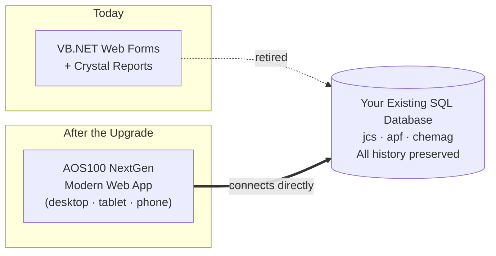

# AOS100 NextGen
## Same Data. Modern System. Built for the Next Decade.

> **Prepared for:** JCS Chemical Industries, Inc. · APF Corporation · Chemag Trading Corporation
> **Live preview:** [https://jcs-co-web.vercel.app](https://jcs-co-web.vercel.app)

---

## 1 · Where AOS100 Stands Today

AOS100 has kept three companies running for years, and it got there on technology from another era.

| Today's Foundation | What It Means for the Business |
| :--- | :--- |
| **VB.NET + ASP.NET Web Forms** | Microsoft no longer develops this platform. Fewer developers know it every year. |
| **.NET Framework 4.6** | Microsoft support ended in April 2022, so it gets no new fixes. |
| **SAP Crystal Reports 13** | 32/64-bit runtime crashes, and it can't run on modern cloud infrastructure. |
| **Desktop-first screens** | Approvals and reports need someone at an office PC. |
| **Older security patterns** | Reversible password storage and SQL queries built from typed-in text. |

> **The risk:** every year on the old platform makes the next change slower, costlier and riskier.

---

## 2 · The Promise

<table>
<tr>
<td align="center" width="33%">

### 🗄️ Keep
**Your existing SQL database**
Every record, every year of history, untouched.

</td>
<td align="center" width="33%">

### ⚡ Modernize
**Everything your team touches**
New screens, new speed, new security.

</td>
<td align="center" width="33%">

### 🛡️ Protect
**Your business continuity**
No big-bang data migration. No lost data.

</td>
</tr>
</table>

> **We replace the engine and the dashboard. Your data stays where it is.**

---

## 3 · Your Data Stays Where It Is



**Why this matters to you:**

- ✅ **No data migration project.** Your history, balances and masterfiles stay in place.
- ✅ **Lower risk.** The data your auditors and accountants already trust stays the same data.
- ✅ **Faster delivery.** Effort goes into features you can see, not into moving records around.
- ✅ **A safety net.** The current system stays available as a fallback during rollout.
- ✅ **Your choice later.** You can upgrade the database separately, on your own timeline, if you ever want to.

---

## 4 · Before → After

| | **Current AOS100** | **AOS100 NextGen** |
| :--- | :--- | :--- |
| 🎨 **User Experience** | Dated forms and full-page reloads | Clean modern interface with instant screen changes and keyboard shortcuts |
| 📱 **Responsive Design** | Built for desktop | Works on desktop, tablet and phone, and installs like an app |
| ⚡ **Performance** | Slow pages on large ledgers | Large tables stay smooth because only the rows on screen are drawn. Target: under 0.2 s for most actions |
| 🔐 **Security** | Reversible passwords and gaps in query handling | Industry-standard password hashing, protected queries and account lockout |
| 🧾 **Reports & Cheques** | Crystal Reports runtime issues | Modern PDF engine for cheques, BIR 2307 and financial statements |
| 🛠️ **Maintainability** | Legacy VB.NET that few developers know | TypeScript, one of the most widely used business languages today |
| 📈 **Scalability** | Tied to one on-premise server | Runs on-premise or in the cloud, and handles more users and new companies easily |
| 🚀 **Future Enhancements** | Each change is slow and risky | New features ship in weeks, not months |

---

## 5 · What Each Team Will Notice

| Role | The Difference on Day One |
| :--- | :--- |
| **CFO / Finance Director** | Live dashboards across all three companies. Approve from your phone. |
| **Senior Accountant** | Journal vouchers balance-checked automatically, plus a Maker-Checker approval flow. |
| **Accounts Payable** | Faster vouchers with automatic VAT and EWT, and precisely aligned cheque printing. |
| **Cashier / Treasury** | Simpler collection entry and automatic daily collection reports. |
| **Tax & Compliance** | BIR Form 2307 generated, not typed by hand. |
| **IT / Auditors** | Role-based access and a full audit trail of who changed what and when. |

---

## 6 · Security You Can Show an Auditor

<table>
<tr>
<td width="50%">

**🔑 Strong identity**
- Modern password hashing (Argon2id)
- Automatic lockout after repeated failed logins
- Secure, short-lived login sessions

</td>
<td width="50%">

**🧱 Strong controls**
- Role-based access per user and per company
- Maker-Checker: whoever prepares a voucher can't also approve it
- Audit trail recording every change

</td>
</tr>
<tr>
<td width="50%">

**🛡️ Strong code**
- Every database query protected against injection
- Input checked on both screen and server
- Encrypted connections (HTTPS) everywhere

</td>
<td width="50%">

**🏢 Strong separation**
- JCS, APF and Chemag data stay strictly separated
- Switch companies instantly without logging out
- Every action stamped with user, company and time

</td>
</tr>
</table>

---

## 7 · Built on Technology That Lasts

| Modern Technology | Why It Matters to You |
| :--- | :--- |
| **Next.js + React** | The same web platform behind many of the world's largest websites |
| **TypeScript** | Catches errors before release, and skilled developers are easy to find |
| **Tailwind + modern UI components** | One consistent, accessible look across every module |
| **Docker containers** | Runs the same way on your server or in the cloud, with simple, repeatable deployments |
| **Your existing SQL database** | Proven, trusted and already holding your data |

> **The result:** a system your team can grow for the next 10 years, not one you're nursing along.

---

## 8 · A Low-Risk, Phased Rollout

```
 PHASE 1            PHASE 2              PHASE 3               PHASE 4
 Foundation    →    Financial Core   →   Cash, Tax &      →    Reports &
                                         Materials             Go-Live
 ─────────────      ──────────────       ──────────────        ──────────────
 Secure login       General Ledger       Collections           Financial
 Company switch     Journal Vouchers     BIR Form 2307         Statements
 Masterfiles        Payables & Cheques   Materials (MMRR)      Audit Trail
                                                               Parallel check & cutover
```

- **About 16 weeks** in eight two-week sprints, with a working demo at the end of every sprint.
- **The same database throughout,** so no cutover weekend spent moving data.
- **Go-live sign-off** only after reports match the current system to the centavo.

---

## 9 · Next Steps

> *"Your data is already your most valuable asset. Let's give it the system it deserves, without putting any of it at risk."*

1. **See it live:** [https://jcs-co-web.vercel.app](https://jcs-co-web.vercel.app)
2. **Discovery session (30 min):** confirm module priorities and user roles.
3. **Pilot:** connect NextGen to a copy of your database and see your own data in the new system.

### **AOS100 NextGen: your data, upgraded.**
